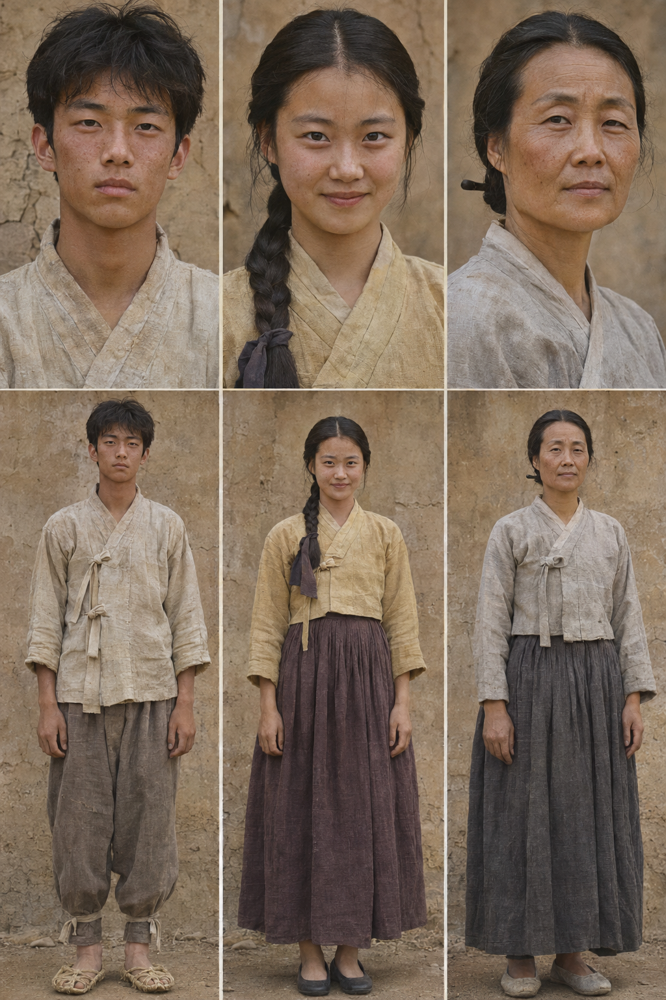

# 동백꽃 — 캐릭터 설명과 캐릭터 시트

기준: 승인된 10씬·240초 시나리오. 첨부 이미지는 표 구성 참고용이다. 첨부 예시의 20세 설정·11씬·아버지 인물은 현재 대본에 반영하지 않는다. 정확한 시각화 나이·의상·외형은 제작 제안이다.

인물 설명의 성격·목표는 시나리오 행동에 근거한 연출 해석이다. 새로운 사건이나 대사를 추가하지 않는다.

사용자가 최초 생성한 3인 얼굴·전신 공통 보드를 최종 제작 기준으로 선택했다. 이후 생성한 앞·뒤·고름 수정 시트는 채택하지 않는다. 선택된 원본에는 후면이 없으며 후면 확정본을 만든 것으로 기록하지 않는다. 사용자 제공 기준: 둥근 고는 착용자 왼쪽(정면 화면 오른쪽). 긴 고름·짧은 고름·매듭 위치·섶 겹침은 구분하여 검토한다. 참고 링크와 검토 범위는 COSTUME_REFERENCE_NOTES.md에 기록한다. 의상 고름·여밈 자료 대조는 미완료이며, 이미지로 역사 고증이 입증되는 것은 아니다. 인터넷 접근 제한으로 이전 고증 확인이 막혔던 사실을 유지한다.

## C01 — 나

- **나이·외형 제안:** 원작의 청소년 / 시각화 제안 약 17세. 마른 체격, 짧고 헝클어진 검은 머리, 햇볕에 그을린 얼굴
- **소속·신분:** 소작농의 아들
- **캐릭터 설명:** 점순이가 건네는 호의를 알아채지 못한다. 닭을 보호하려다가 충동적으로 나뭇가지를 휘두른다. 닭이 죽자 소작 관계의 압박을 말로 드러낸다. 성격 해석: 무뚝뚝함·서투름·성급함.
- **행동 목표·극적 기능:** 자기 닭을 보호하려는 행동이 갈등을 확대한다. 사건 이후 점순이의 제안을 받아들이며 관계가 바뀐다.
- **감정·행동 변화:** S01 고개 돌림 → S02~05 닭 보호·항의 → S06 달려감 → S07~08 가지를 쥠·휘두름 → S09 눈물·끄덕임 → S10 점순이를 바라봄
- **화면 등장 씬:** S01, S02, S03, S04, S05, S06, S07, S08, S09, S10
- **음성만 등장:** 없음
- **대사:** 있음
- **사용 언어:** 한국어 / 강원 농촌 말맛을 절제해 사용
- **의상·분장 노트:** 미색 무명 저고리·회갈색 바지·짚신 제안. 손·무릎 흙 유지. S09 눈물과 젖은 소매, S10 풀 부착.
- **캐릭터 시트 우선순위:** 최상 / 전 씬 얼굴 일관성
- **시트 파일:** assets/references/characters.png
- **확정·검토 상태:** 최초 공통 보드 사용자 선택 완료. 후속 수정 이미지 미채택. 원작의 정확한 나이 확정 아님. 고름·여밈 인터넷 고증 미완료.

## C02 — 점순이

- **나이·외형 제안:** 원작의 청소년 / 시각화 제안 약 17세. 둥근 얼굴, 검은 긴 댕기머리, 활기 있는 시선
- **소속·신분:** 마름의 딸
- **캐릭터 설명:** 감자를 건네지만 거절당한다. 닭싸움을 붙이고 나를 놀린다. 수탉이 죽은 뒤에는 일을 감춰 주겠다고 한다. 성격 해석: 적극성·짓궂음·서툰 호의. 단순한 악역으로 처리하지 않는다.
- **행동 목표·극적 기능:** 감자·닭·호드기로 상대의 주의를 끈다. 마지막에는 약속을 제안하며 갈등을 전환한다.
- **감정·행동 변화:** S01 손 거둠 → S02 팔짱 → S05 짧은 웃음 → S06 멀리서 놀림 → S07 호드기 내려놓음 → S08 질문 → S09 다가감 → S10 웃음·퇴장
- **화면 등장 씬:** S01, S02, S05, S07, S08, S09, S10
- **음성만 등장:** S06
- **대사:** 있음
- **사용 언어:** 한국어 / 나와 같은 지역의 말맛
- **의상·분장 노트:** 황토색 무명 저고리·짙은 자주색 치마·검은 고무신·어두운 댕기 제안. 머리 길이·옷색 고정. S10 풀 부착.
- **캐릭터 시트 우선순위:** 최상 / 얼굴·댕기·의상 유지
- **시트 파일:** assets/references/characters.png
- **확정·검토 상태:** 최초 공통 보드 사용자 선택 완료. 후속 수정 이미지 미채택. 눈빛·표정은 씬에 따라 변화. 고름·여밈 인터넷 고증 미완료.

## C03 — 나의 어머니

- **나이·외형 제안:** 중년 / 시각화 제안 약 45세. 생활 주름, 햇볕에 그을린 얼굴, 낮게 쪽진 머리
- **소속·신분:** 소작농의 아내 / 나의 어머니
- **캐릭터 설명:** 닭의 깃털을 살핀다. 점순이네를 가리키는 아들의 손목을 내린다. 밭을 잃을 수 있다는 경고로 두 집의 힘 차이를 드러낸다. 성격 해석: 생활에 신중하고 현실적인 보호자.
- **행동 목표·극적 기능:** 짧은 등장으로 소작 관계의 압박을 전달하고 S09의 두려움을 준비한다.
- **감정·행동 변화:** S03 닭 살핌 → 손목 내림 → 경고
- **화면 등장 씬:** S03
- **음성만 등장:** 없음
- **대사:** 있음
- **사용 언어:** 한국어 / 절제된 농촌 말투
- **의상·분장 노트:** 회백색 무명 저고리·먹색 치마·낮은 쪽머리·수수한 신발 제안. 손의 생활 흔적.
- **캐릭터 시트 우선순위:** 중 / S03
- **시트 파일:** assets/references/characters.png
- **확정·검토 상태:** 최초 공통 보드 사용자 선택 완료. 후속 수정 이미지 미채택. 고름·여밈 고증 미완료.

## C04 — 점순이 어머니

- **나이·외형 제안:** 외형·정확한 나이 설정 불필요
- **소속·신분:** 점순이의 어머니
- **캐릭터 설명:** 화면 밖에서 점순이를 부른다. 짧은 호출로 꽃밭의 두 사람을 일상으로 돌려보낸다. 대본에 없는 외형·성격·추가 행동을 만들지 않는다.
- **행동 목표·극적 기능:** “점순아!” 한마디가 점순이의 퇴장을 유도한다.
- **감정·행동 변화:** S10 멀리서 부름
- **화면 등장 씬:** 없음
- **음성만 등장:** S10
- **대사:** 있음 / “점순아!”
- **사용 언어:** 한국어 / 먼 거리의 여성 음성
- **의상·분장 노트:** 화면에 등장하지 않으므로 의상 제작 불필요. C03과 구분되는 음색.
- **캐릭터 시트 우선순위:** 음성 우선 / 이미지 불필요
- **시트 파일:** 없음
- **확정·검토 상태:** 목소리만 제작. 이미지 생성하지 않음.

## 표정 및 상태 추가 제작 계획

- 나: 기본 중립 표정은 현재 시트. 항의·눈물·꽃밭 시선은 씬별 추가 제작 대상.
- 점순이: 기본 표정은 현재 시트. 감자 거절 직후·놀림·수탉의 죽음·꽃밭 미소는 추가 제작 대상.
- 어머니: 닭을 살피는 시선과 경고 대사는 S03에서 제작.
- 동일 인물 참조를 사용해도 얼굴·옷색·매듭·손·뒷머리가 달라질 수 있으므로 최종 씬마다 검토한다.
