# 동백꽃 — Flow AI 편집본 v1.1

사용자 수정 반영: 어머니는 전부 화면 밖 음성. 닭싸움에 어머니가 등장하지 않는다. 최초 시나리오 파일은 이력으로 보존한다. 현재 제작은 이 편집본과 data.js를 기준으로 한다.

10씬·35컷·총 240초. Flow의 8초 생성 기준으로 35개 영상(총 생성 280초)을 만들고 앞 4~8초를 사용하여 240초로 편집한다. 선택 모델의 지원 길이는 Flow에서 확인한다. 한국어 음성이 불명확하면 별도 음성으로 편집한다. 각 컷의 첫 프레임은 해당 컷 번호 PNG이며 후속 행동 이전의 자세다. 등록 영상은 S01-01~S01-04의 4개이며 나머지 컷은 키 이미지 단계다.


## S01 감자 세 알 — 25초

등장: 나 C01 / 점순이 C02


### S01-01 · 0–8초 · 생성8초/편집8초

시작: 밭일 직전

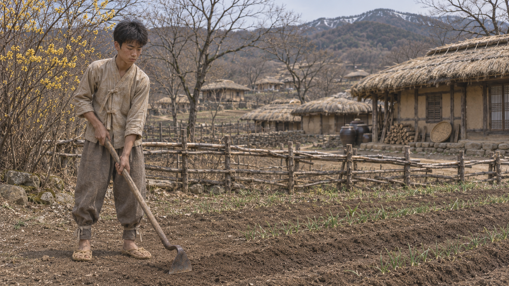

#### 영상 한글
```text
S01-01 | Flow AI | 생성 8초 / 편집 8초
1930년대 강원 농촌, 이른 봄. 16:9 시네마틱 실사, 자연광, 흙빛 색감.
시작 상태: 밭일 직전 — 첨부 키 이미지와 동일한 상태.
행동: 나가 괭이로 흙을 고른다.
카메라: 와이드·눈높이·고정. 시작 이미지와 같은 앵글, 한 번의 연속 숏, 임의 컷 전환 없음.
대사 없음.
환경음·효과음: 흙을 긁는 쇠날, 먼 닭소리.
첫 프레임은 첨부한 S01-01.png 그대로 시작한다. 최초 선택 인물의 얼굴·머리·의상·고름·체형과 소품·광선을 유지한다. 화면에 어머니나 제3인물, 추가 손을 만들지 않는다. 어머니는 S03과 S10에서만 화면 밖 음성이다. 배경음악·설명 내레이션·화면 글자·자막·캡션·워터마크 없음. 동물 타격 접촉·상처·피 없음.
생성 길이 8초. 편집본에는 앞 8초를 사용한다. 핵심 동작과 대사는 8초 안에 끝내고 남은 시간은 종료 자세를 자연스럽게 유지한다.
```

#### Video English
```text
S01-01 | Flow AI | Generate 8s / Edit 8s
Early spring, 1930s rural Gangwon Korea. 16:9 cinematic live action, natural light, earthy palette.
START STATE: Boy alone frame left at vegetable plot, hoe blade resting on soil, both hands on handle, gaze downward, BEFORE drawing hoe through soil. Wide eye-level shot. Low branch fence and distant thatched houses. Noon.
ACTION: The boy works the earth with his hoe.
CAMERA: Wide, eye level, locked off; maintain start-frame angle, one continuous shot, no spontaneous cuts.
No dialogue.
Diegetic sounds: Hoe scraping soil, distant rooster.
Start exactly from the attached S01-01.png. Preserve original approved identities, hair, clothing, goreum, body builds, props and light. NO mother or third human or extra hands appears. Mothers are offscreen voices only in S03 and S10. No music, narration, on-screen text, subtitles, captions or watermark; no animal impact, wounds or blood.
Generate 8 seconds. Use the FIRST 8 seconds in the edit. Finish the essential action and dialogue within 8 seconds, then hold the final posture naturally.
```

#### 시작 이미지 프롬프트
```text
ONE single WIDE 16:9 live-action photorealistic START FRAME of an 8-second film clip. Early spring, 1930s rural Gangwon Korea, muted earth colors, unretouched skin, natural soft light, subtle film grain. Identity reference contains ONLY boy on left and girl on right: faithfully preserve their faces, bodies, original hair, original clothing and original goreum knots. Boy: short untidy black hair, faded ivory jeogori, grey-brown baji, straw sandals. Girl: round face, one black braid with dark ribbon, muted ochre jeogori, dark plum chima, black rubber shoes. Use location and prop boards only for environment/object appearance, never their layout. CRITICAL: NO MOTHER, NO ADULT WOMAN, NO THIRD HUMAN, NO bystander, NO extra hands, NO silhouette. Include only explicitly requested characters; if an isolated closeup, no other face. Image is the instant BEFORE the named action, not mid-action or its ending. No collage, no panels, no text, no captions, no logo, no modern objects, no costume redesign, no animal impact/blood/wounds. Spicebush flowers yellow, not red camellia. Hodeugi is a short straight bark tube, not a smoking pipe. START COMPOSITION: Boy alone frame left at vegetable plot, hoe blade resting on soil, both hands on handle, gaze downward, BEFORE drawing hoe through soil. Wide eye-level shot. Low branch fence and distant thatched houses. Noon.
```


### S01-02 · 8–16초 · 생성8초/편집8초

시작: 감자를 내밀기 직전

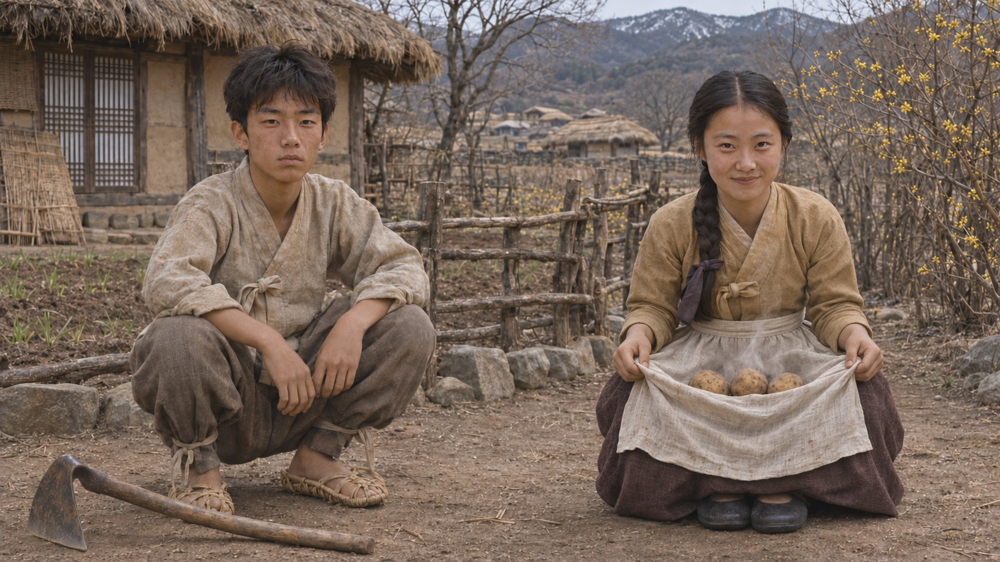

#### 영상 한글
```text
S01-02 | Flow AI | 생성 8초 / 편집 8초
1930년대 강원 농촌, 이른 봄. 16:9 시네마틱 실사, 자연광, 흙빛 색감.
시작 상태: 감자를 내밀기 직전 — 첨부 키 이미지와 동일한 상태.
행동: 점순이는 나의 얼굴을 보며 흰색 무명 앞치마에 감싼 뜨거운 감자 세 알을 조심스럽게 내민다. 나는 앞치마의 감자를 내려다본다. 두 사람은 카메라를 보지 않는다. 손은 천의 가장자리만 잡는다.
카메라: 미디엄 투숏·35mm·느린 전진. 시작 이미지와 같은 앵글, 한 번의 연속 숏, 임의 컷 전환 없음.
한국어 육성 대사: 점순이: 느 집엔 이런 거 없지? 뜨거울 때 먹어.
환경음·효과음: 바람, 옷자락.
첫 프레임은 첨부한 S01-02.png 그대로 시작한다. 최초 선택 인물의 얼굴·머리·의상·고름·체형과 소품·광선을 유지한다. 화면에 어머니나 제3인물, 추가 손을 만들지 않는다. 어머니는 S03과 S10에서만 화면 밖 음성이다. 배경음악·설명 내레이션·화면 글자·자막·캡션·워터마크 없음. 동물 타격 접촉·상처·피 없음.
생성 길이 8초. 편집본에는 앞 8초를 사용한다. 핵심 동작과 대사는 8초 안에 끝내고 남은 시간은 종료 자세를 자연스럽게 유지한다.
흰 무명 허리 앞치마로 감자 세 알을 감싼다. 손은 앞치마 천만 잡는다. 맨손으로 뜨거운 감자를 잡지 않는다.
```

#### Video English
```text
S01-02 | Flow AI | Generate 8s / Edit 8s
Early spring, 1930s rural Gangwon Korea. 16:9 cinematic live action, natural light, earthy palette.
START STATE: Boy crouches frame left beside the hoe with hands on his knees, torso turned toward Jeomsun and eyes lowered to the potatoes. Jeomsun crouches frame right, body turned toward the boy and eyes on his face with a small tentative smile. NEITHER looks at the camera. Girl wears a plain WHITE COTTON WAIST APRON over her plum skirt and lifts the lower apron hem into a pouch near her lap containing EXACTLY THREE steaming potatoes. Fingers grip ONLY apron edges, never hot potatoes, BEFORE extending this cloth pouch toward boy. Medium two-shot. Both faces visible. Noon.
ACTION: Jeomsun looks at the boy’s face and carefully extends her white cotton apron pouch with exactly three hot potatoes. The boy looks down at the potatoes. Neither looks into the camera. Her fingers grip only cloth edges, never potatoes.
CAMERA: Medium two-shot, 35mm, slow push in; maintain start-frame angle, one continuous shot, no spontaneous cuts.
Spoken ORIGINAL KOREAN, never translated: 점순이: 느 집엔 이런 거 없지? 뜨거울 때 먹어.
Diegetic sounds: Breeze, cloth rustle.
Start exactly from the attached S01-02.png. Preserve original approved identities, hair, clothing, goreum, body builds, props and light. NO mother or third human or extra hands appears. Mothers are offscreen voices only in S03 and S10. No music, narration, on-screen text, subtitles, captions or watermark; no animal impact, wounds or blood.
Generate 8 seconds. Use the FIRST 8 seconds in the edit. Finish the essential action and dialogue within 8 seconds, then hold the final posture naturally.
White cotton waist apron cradles exactly three hot potatoes. Fingers hold cloth edges only, never the potatoes.
```

#### 시작 이미지 프롬프트
```text
ONE single WIDE 16:9 live-action photorealistic START FRAME of an 8-second film clip. Early spring, 1930s rural Gangwon Korea, muted earth colors, unretouched skin, natural soft light, subtle film grain. Identity reference contains ONLY boy on left and girl on right: faithfully preserve their faces, bodies, original hair, original clothing and original goreum knots. Boy: short untidy black hair, faded ivory jeogori, grey-brown baji, straw sandals. Girl: round face, one black braid with dark ribbon, muted ochre jeogori, dark plum chima, black rubber shoes. Use location and prop boards only for environment/object appearance, never their layout. CRITICAL: NO MOTHER, NO ADULT WOMAN, NO THIRD HUMAN, NO bystander, NO extra hands, NO silhouette. Include only explicitly requested characters; if an isolated closeup, no other face. Image is the instant BEFORE the named action, not mid-action or its ending. No collage, no panels, no text, no captions, no logo, no modern objects, no costume redesign, no animal impact/blood/wounds. Spicebush flowers yellow, not red camellia. Hodeugi is a short straight bark tube, not a smoking pipe. START COMPOSITION: Boy crouches frame left beside the hoe with hands on his knees, torso turned toward Jeomsun and eyes lowered to the potatoes. Jeomsun crouches frame right, body turned toward the boy and eyes on his face with a small tentative smile. NEITHER looks at the camera. Girl wears a plain WHITE COTTON WAIST APRON over her plum skirt and lifts the lower apron hem into a pouch near her lap containing EXACTLY THREE steaming potatoes. Fingers grip ONLY apron edges, never hot potatoes, BEFORE extending this cloth pouch toward boy. Medium two-shot. Both faces visible. Noon.
```


### S01-03 · 16–21초 · 생성8초/편집5초

시작: 거절 직전

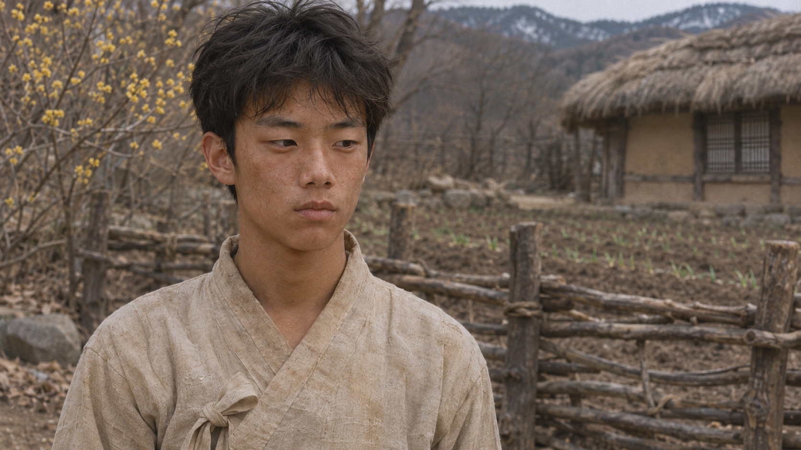

#### 영상 한글
```text
S01-03 | Flow AI | 생성 8초 / 편집 5초
1930년대 강원 농촌, 이른 봄. 16:9 시네마틱 실사, 자연광, 흙빛 색감.
시작 상태: 거절 직전 — 첨부 키 이미지와 동일한 상태.
행동: 나가 내민 감자를 흘끗 본다. 나가 고개를 돌린다.
카메라: 얼굴 클로즈업·65mm·고정. 시작 이미지와 같은 앵글, 한 번의 연속 숏, 임의 컷 전환 없음.
한국어 육성 대사: 나: 안 먹어. 너나 먹어.
환경음·효과음: 멀리 우는 닭 / 바람, 숨.
첫 프레임은 첨부한 S01-03.png 그대로 시작한다. 최초 선택 인물의 얼굴·머리·의상·고름·체형과 소품·광선을 유지한다. 화면에 어머니나 제3인물, 추가 손을 만들지 않는다. 어머니는 S03과 S10에서만 화면 밖 음성이다. 배경음악·설명 내레이션·화면 글자·자막·캡션·워터마크 없음. 동물 타격 접촉·상처·피 없음.
생성 길이 8초. 편집본에는 앞 5초를 사용한다. 핵심 동작과 대사는 5초 안에 끝내고 남은 시간은 종료 자세를 자연스럽게 유지한다.
```

#### Video English
```text
S01-03 | Flow AI | Generate 8s / Edit 5s
Early spring, 1930s rural Gangwon Korea. 16:9 cinematic live action, natural light, earthy palette.
START STATE: Boy face closeup, neutral guarded look toward potatoes just offscreen right, BEFORE turning his head away. Ivory jeogori visible, same fence softly behind. Girl outside crop. Noon.
ACTION: The boy glances at the offered potatoes. The boy turns his face away.
CAMERA: Face close-up, 65mm, locked off; maintain start-frame angle, one continuous shot, no spontaneous cuts.
Spoken ORIGINAL KOREAN, never translated: 나: 안 먹어. 너나 먹어.
Diegetic sounds: Distant rooster / Breeze, breath.
Start exactly from the attached S01-03.png. Preserve original approved identities, hair, clothing, goreum, body builds, props and light. NO mother or third human or extra hands appears. Mothers are offscreen voices only in S03 and S10. No music, narration, on-screen text, subtitles, captions or watermark; no animal impact, wounds or blood.
Generate 8 seconds. Use the FIRST 5 seconds in the edit. Finish the essential action and dialogue within 5 seconds, then hold the final posture naturally.
```

#### 시작 이미지 프롬프트
```text
ONE single WIDE 16:9 live-action photorealistic START FRAME of an 8-second film clip. Early spring, 1930s rural Gangwon Korea, muted earth colors, unretouched skin, natural soft light, subtle film grain. Identity reference contains ONLY boy on left and girl on right: faithfully preserve their faces, bodies, original hair, original clothing and original goreum knots. Boy: short untidy black hair, faded ivory jeogori, grey-brown baji, straw sandals. Girl: round face, one black braid with dark ribbon, muted ochre jeogori, dark plum chima, black rubber shoes. Use location and prop boards only for environment/object appearance, never their layout. CRITICAL: NO MOTHER, NO ADULT WOMAN, NO THIRD HUMAN, NO bystander, NO extra hands, NO silhouette. Include only explicitly requested characters; if an isolated closeup, no other face. Image is the instant BEFORE the named action, not mid-action or its ending. No collage, no panels, no text, no captions, no logo, no modern objects, no costume redesign, no animal impact/blood/wounds. Spicebush flowers yellow, not red camellia. Hodeugi is a short straight bark tube, not a smoking pipe. START COMPOSITION: Boy face closeup, neutral guarded look toward potatoes just offscreen right, BEFORE turning his head away. Ivory jeogori visible, same fence softly behind. Girl outside crop. Noon.
```


### S01-04 · 21–25초 · 생성8초/편집4초

시작: 거절 직후 — 무안함이 분노로 바뀌기 직전

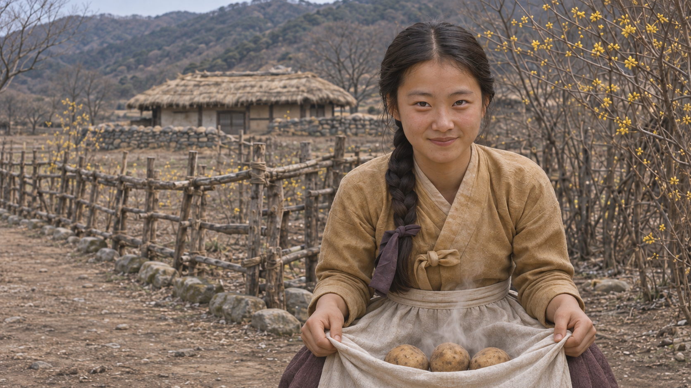

#### 영상 한글
```text
S01-04 — 감자를 거절당한 점순이의 무안함과 분노
생성 8초 / 편집 4초.

첨부한 S01-04.png를 정확한 첫 프레임으로 사용한다.
바로 앞 장면에서 소년이 감자를 거절했다.
카메라는 소년의 시점이다. 화면에는 점순이만 보인다.

0~1초: 점순이의 남아 있던 미소가 뚝 멎는다. 소년을 바라보던 눈이 잠시 멈춘다.
1~2초: 시선을 아래로 떨군다. 입술을 꾹 다문다. 앞치마 가장자리를 쥔 손에 힘이 들어간다.
2~3초: 감자 세 알이 담긴 앞치마를 몸 쪽으로 당긴다. 눈썹 안쪽이 살짝 모인다.
3~4초: 고개를 조금 들고 소년을 날카롭게 쏘아본다. 입술은 굳게 다물려 있다. 무안함이 화로 바뀐 표정이 분명하게 보인다.
4~8초: 소년을 쏘아보는 시선과 화난 표정을 유지한다. 다시 웃거나 부드러운 표정으로 돌아가지 않는다.

원본 얼굴형·눈·코·입·피부·머리·의상·고름·체형을 유지한다.
같은 얼굴에서 표정과 눈빛만 자연스럽게 변한다. 다른 인물처럼 얼굴형을 바꾸거나 나이를 더하지 않는다.
감자는 끝까지 흰 무명 앞치마 천으로 받친다. 손은 천 가장자리만 잡는다.
감자를 다시 권하거나 건네거나 던지지 않는다.
소년·어머니·다른 인물·동물을 화면에 추가하지 않는다.

처음부터 얼굴과 앞치마가 함께 보이는 눈높이 미디엄 클로즈업, 50mm, 고정 카메라.
줌·틸트·컷 전환 없음.
소리: 앞치마 천이 당겨지는 소리, 짧은 숨, 약한 바람.
대사·배경음악·내레이션·자막·화면 글자 없음.
1930년대 강원 농촌의 이른 봄, 16:9 시네마틱 실사.
첫 4초 안에 무안함에서 분노로 바뀌는 핵심 반응을 끝내고, 편집에는 앞 4초를 사용한다.
```

#### Video English
```text
S01-04 — Jeomsun's embarrassment turns into anger after rejection.
Generate 8 seconds / Use the first 4 seconds.

Use the attached S01-04.png as the exact first frame.
The boy has just refused her potatoes in the preceding shot.
The camera is the boy's point of view. Only Jeomsun is visible.

0–1s: Her remaining smile abruptly stops. Her eyes momentarily hold on the boy.
1–2s: She drops her gaze, presses her lips firmly together and tightens her grip on the apron edges.
2–3s: She draws the apron pouch with exactly three potatoes against her body. Her inner brows draw slightly together.
3–4s: She lifts her head a little and gives the boy a sharp, angry look. Her lips stay firmly closed. The shift from embarrassment to anger must be clearly readable.
4–8s: Hold her angry gaze and firm expression. Do not return to smiling or a soft expression.

Preserve the original facial structure, eyes, nose, mouth, skin, hair, clothes, goreum and body.
Allow natural expression changes on the SAME face; do not replace her identity or age her.
The white cotton apron supports all three potatoes throughout. Fingers grip cloth edges only.
Do not offer, hand over or throw potatoes.
No boy, mother, other person or animal enters the image.

Eye-level medium close-up, 50mm, locked-off camera, face and apron visible from the first frame.
No zoom, tilt or cuts.
Diegetic sound only: apron cloth pulling, a short breath, soft breeze.
No dialogue, music, narration, subtitles, captions or on-screen text.
Early spring, 1930s rural Gangwon Korea, 16:9 cinematic live action.
Finish the essential embarrassment-to-anger reaction within the first 4 seconds; use those 4 seconds in the edit.
```

#### 시작 이미지 프롬프트
```text
OUTPAINT THE MOST RECENT USER-UPLOADED REFERENCE PORTRAIT ONLY into a wide 16:9 cinematic first frame. Do NOT use any earlier generated alternate girl. This task is background/canvas extension, NOT a new portrait or face redesign. Keep the reference girl's face, expression, original small closed-mouth smile, exact face silhouette, full cheeks, softly rounded jaw, eye shape and spacing, original eyelids and eyebrows, nose shape, lips, skin texture, hairline, center-parted braided black hair and dark ribbon exactly as in the uploaded reference. Keep the ORIGINAL HEAD ANGLE and ORIGINAL EYE DIRECTION. DO NOT alter her expression, rotate the head, age her, slim her face, sharpen jaw, enlarge eyes, or add wrinkles, freckles, frown or new facial detail. Preserve her original worn ochre jacket and its knot arrangement, plum skirt and white waist apron exactly as shown. Preserve the source portrait as the central photographic subject; extend primarily the rural background horizontally to create 16:9, with the girl center-right and useful negative space to left. Extend the existing low rough wooden fence, thatched Korean farmhouse, earth and bare early-spring hills under matching daylight. No new person, boy, mother, animal or tool. At the lower frame keep her lifted WHITE COTTON APRON hem forming a cloth pouch with EXACTLY THREE potatoes; fingers hold cloth edges, never potatoes. Preserve original hand pose wherever visible. Frame head to waist/apron, realistic natural body proportions. This is S01-04 first frame from the unseen boy's point of view: she looks toward him at camera position, still wearing her ORIGINAL slight smile just before registering his refusal. The smile will fade IN THE VIDEO, so do NOT change it in this image. Photorealistic period film still, 1930s Korean village, restrained natural earthy light, no text, captions, panels, borders or watermark. Absolute priority is faithful preservation of the face from the most recent user photo, not creating a lookalike.
```


## S02 울타리 너머 — 20초

등장: 나 C01 / 점순이 C02


### S02-01 · 25–33초 · 생성8초/편집8초

시작: 수탉을 내려놓기 직전

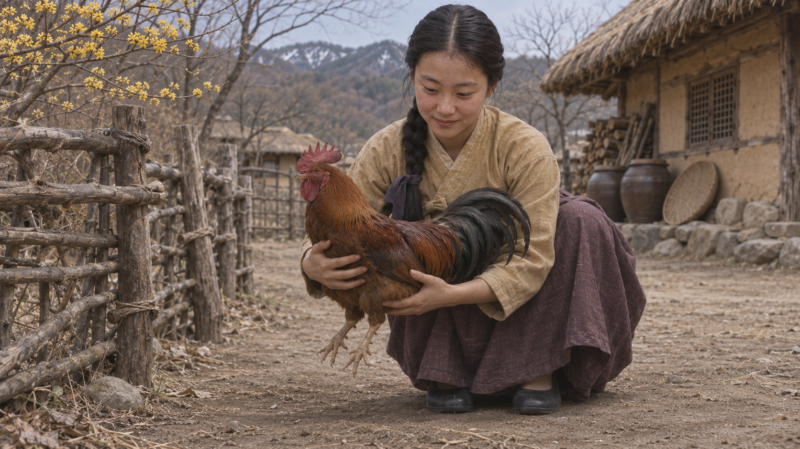

#### 영상 한글
```text
S02-01 | Flow AI | 생성 8초 / 편집 8초
1930년대 강원 농촌, 이른 봄. 16:9 시네마틱 실사, 자연광, 흙빛 색감.
시작 상태: 수탉을 내려놓기 직전 — 첨부 키 이미지와 동일한 상태.
행동: 점순이가 큰 수탉을 울타리 밖에 내려놓는다.
카메라: 미디엄·낮은 눈높이·고정. 시작 이미지와 같은 앵글, 한 번의 연속 숏, 임의 컷 전환 없음.
대사 없음.
환경음·효과음: 가벼운 날갯짓.
첫 프레임은 첨부한 S02-01.png 그대로 시작한다. 최초 선택 인물의 얼굴·머리·의상·고름·체형과 소품·광선을 유지한다. 화면에 어머니나 제3인물, 추가 손을 만들지 않는다. 어머니는 S03과 S10에서만 화면 밖 음성이다. 배경음악·설명 내레이션·화면 글자·자막·캡션·워터마크 없음. 동물 타격 접촉·상처·피 없음.
생성 길이 8초. 편집본에는 앞 8초를 사용한다. 핵심 동작과 대사는 8초 안에 끝내고 남은 시간은 종료 자세를 자연스럽게 유지한다.
```

#### Video English
```text
S02-01 | Flow AI | Generate 8s / Edit 8s
Early spring, 1930s rural Gangwon Korea. 16:9 cinematic live action, natural light, earthy palette.
START STATE: Jeomsun alone visible, crouched beside fence holding the larger chestnut rooster securely with both hands just above earth, BEFORE setting it down. Medium low eye-level. No boy in this crop, no other humans. Noon.
ACTION: Jeomsun sets the larger rooster down outside the fence.
CAMERA: Medium, low eye level, locked off; maintain start-frame angle, one continuous shot, no spontaneous cuts.
No dialogue.
Diegetic sounds: Light wingbeats.
Start exactly from the attached S02-01.png. Preserve original approved identities, hair, clothing, goreum, body builds, props and light. NO mother or third human or extra hands appears. Mothers are offscreen voices only in S03 and S10. No music, narration, on-screen text, subtitles, captions or watermark; no animal impact, wounds or blood.
Generate 8 seconds. Use the FIRST 8 seconds in the edit. Finish the essential action and dialogue within 8 seconds, then hold the final posture naturally.
```

#### 시작 이미지 프롬프트
```text
ONE single WIDE 16:9 live-action photorealistic START FRAME of an 8-second film clip. Early spring, 1930s rural Gangwon Korea, muted earth colors, unretouched skin, natural soft light, subtle film grain. Identity reference contains ONLY boy on left and girl on right: faithfully preserve their faces, bodies, original hair, original clothing and original goreum knots. Boy: short untidy black hair, faded ivory jeogori, grey-brown baji, straw sandals. Girl: round face, one black braid with dark ribbon, muted ochre jeogori, dark plum chima, black rubber shoes. Use location and prop boards only for environment/object appearance, never their layout. CRITICAL: NO MOTHER, NO ADULT WOMAN, NO THIRD HUMAN, NO bystander, NO extra hands, NO silhouette. Include only explicitly requested characters; if an isolated closeup, no other face. Image is the instant BEFORE the named action, not mid-action or its ending. No collage, no panels, no text, no captions, no logo, no modern objects, no costume redesign, no animal impact/blood/wounds. Spicebush flowers yellow, not red camellia. Hodeugi is a short straight bark tube, not a smoking pipe. START COMPOSITION: Jeomsun alone visible, crouched beside fence holding the larger chestnut rooster securely with both hands just above earth, BEFORE setting it down. Medium low eye-level. No boy in this crop, no other humans. Noon.
```


### S02-02 · 33–41초 · 생성8초/편집8초

시작: 닭을 떼어놓기 직전

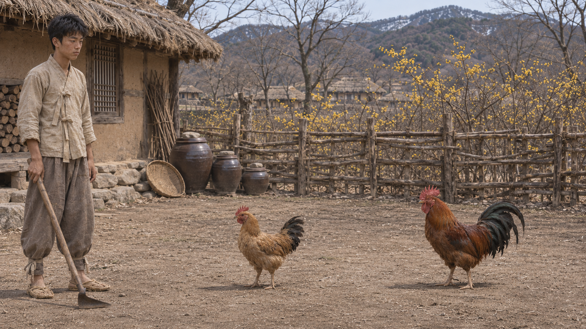

#### 영상 한글
```text
S02-02 | Flow AI | 생성 8초 / 편집 8초
1930년대 강원 농촌, 이른 봄. 16:9 시네마틱 실사, 자연광, 흙빛 색감.
시작 상태: 닭을 떼어놓기 직전 — 첨부 키 이미지와 동일한 상태.
행동: 나가 이미 내려놓은 괭이 옆에서 두 닭 사이로 뛰어든다. 닭은 접촉하지 않는다.
카메라: 로우 앵글·닭 눈높이·고정. 시작 이미지와 같은 앵글, 한 번의 연속 숏, 임의 컷 전환 없음.
한국어 육성 대사: 나: 야! 닭 좀 치워!
환경음·효과음: 닭 울음, 흙 발소리 / 빠른 발소리, 날갯짓.
첫 프레임은 첨부한 S02-02.png 그대로 시작한다. 최초 선택 인물의 얼굴·머리·의상·고름·체형과 소품·광선을 유지한다. 화면에 어머니나 제3인물, 추가 손을 만들지 않는다. 어머니는 S03과 S10에서만 화면 밖 음성이다. 배경음악·설명 내레이션·화면 글자·자막·캡션·워터마크 없음. 동물 타격 접촉·상처·피 없음.
생성 길이 8초. 편집본에는 앞 8초를 사용한다. 핵심 동작과 대사는 8초 안에 끝내고 남은 시간은 종료 자세를 자연스럽게 유지한다.
```

#### Video English
```text
S02-02 | Flow AI | Generate 8s / Edit 8s
Early spring, 1930s rural Gangwon Korea. 16:9 cinematic live action, natural light, earthy palette.
START STATE: Two separate roosters on dirt before fence, small golden-brown left, larger chestnut dark-tailed right, standing apart. Boy at left edge holding hoe safely pointed at ground, BEFORE lowering it and stepping between them. Jeomsun outside crop. Low medium-wide. Noon.
ACTION: The boy steps quickly from beside the hoe already on the ground to separate the two roosters; no animal contact.
CAMERA: Low angle at rooster eye level, locked off; maintain start-frame angle, one continuous shot, no spontaneous cuts.
Spoken ORIGINAL KOREAN, never translated: 나: 야! 닭 좀 치워!
Diegetic sounds: Crowing, feet on dirt / Quick footsteps, flapping.
Start exactly from the attached S02-02.png. Preserve original approved identities, hair, clothing, goreum, body builds, props and light. NO mother or third human or extra hands appears. Mothers are offscreen voices only in S03 and S10. No music, narration, on-screen text, subtitles, captions or watermark; no animal impact, wounds or blood.
Generate 8 seconds. Use the FIRST 8 seconds in the edit. Finish the essential action and dialogue within 8 seconds, then hold the final posture naturally.
```

#### 시작 이미지 프롬프트
```text
ONE single WIDE 16:9 live-action photorealistic START FRAME of an 8-second film clip. Early spring, 1930s rural Gangwon Korea, muted earth colors, unretouched skin, natural soft light, subtle film grain. Identity reference contains ONLY boy on left and girl on right: faithfully preserve their faces, bodies, original hair, original clothing and original goreum knots. Boy: short untidy black hair, faded ivory jeogori, grey-brown baji, straw sandals. Girl: round face, one black braid with dark ribbon, muted ochre jeogori, dark plum chima, black rubber shoes. Use location and prop boards only for environment/object appearance, never their layout. CRITICAL: NO MOTHER, NO ADULT WOMAN, NO THIRD HUMAN, NO bystander, NO extra hands, NO silhouette. Include only explicitly requested characters; if an isolated closeup, no other face. Image is the instant BEFORE the named action, not mid-action or its ending. No collage, no panels, no text, no captions, no logo, no modern objects, no costume redesign, no animal impact/blood/wounds. Spicebush flowers yellow, not red camellia. Hodeugi is a short straight bark tube, not a smoking pipe. START COMPOSITION: Two separate roosters on dirt before fence, small golden-brown left, larger chestnut dark-tailed right, standing apart. Boy at left edge holding hoe safely pointed at ground, BEFORE lowering it and stepping between them. Jeomsun outside crop. Low medium-wide. Noon.
```


### S02-03 · 41–45초 · 생성8초/편집4초

시작: 점순이가 대꾸하기 직전

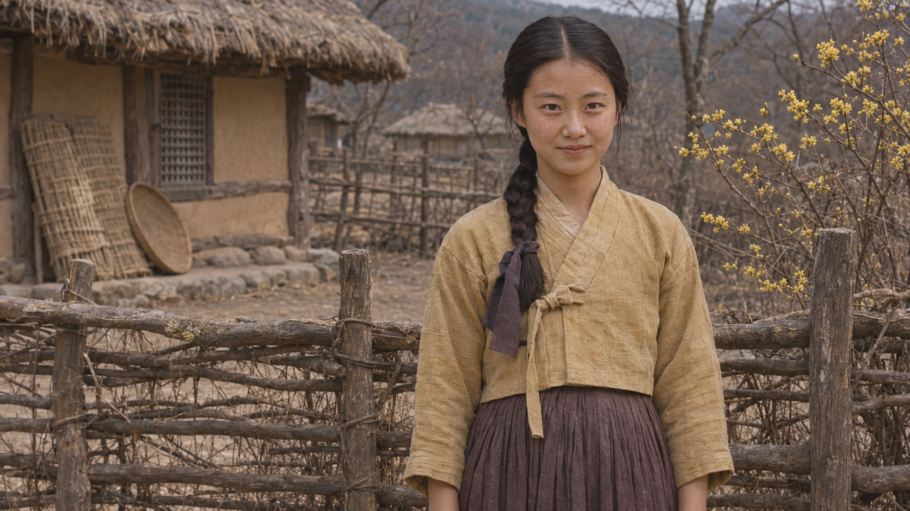

#### 영상 한글
```text
S02-03 | Flow AI | 생성 8초 / 편집 4초
1930년대 강원 농촌, 이른 봄. 16:9 시네마틱 실사, 자연광, 흙빛 색감.
시작 상태: 점순이가 대꾸하기 직전 — 첨부 키 이미지와 동일한 상태.
행동: 점순이가 팔짱을 낀다.
카메라: 미디엄 클로즈업·50mm·고정. 시작 이미지와 같은 앵글, 한 번의 연속 숏, 임의 컷 전환 없음.
한국어 육성 대사: 점순이: 왜? 느 집 닭도 덤비잖아.
환경음·효과음: 옷자락, 닭소리.
첫 프레임은 첨부한 S02-03.png 그대로 시작한다. 최초 선택 인물의 얼굴·머리·의상·고름·체형과 소품·광선을 유지한다. 화면에 어머니나 제3인물, 추가 손을 만들지 않는다. 어머니는 S03과 S10에서만 화면 밖 음성이다. 배경음악·설명 내레이션·화면 글자·자막·캡션·워터마크 없음. 동물 타격 접촉·상처·피 없음.
생성 길이 8초. 편집본에는 앞 4초를 사용한다. 핵심 동작과 대사는 4초 안에 끝내고 남은 시간은 종료 자세를 자연스럽게 유지한다.
```

#### Video English
```text
S02-03 | Flow AI | Generate 8s / Edit 4s
Early spring, 1930s rural Gangwon Korea. 16:9 cinematic live action, natural light, earthy palette.
START STATE: Jeomsun medium closeup at fence, hands loosely at sides, BEFORE folding arms and replying. Boy and birds outside crop. Noon.
ACTION: Jeomsun folds her arms.
CAMERA: Medium close-up, 50mm, locked off; maintain start-frame angle, one continuous shot, no spontaneous cuts.
Spoken ORIGINAL KOREAN, never translated: 점순이: 왜? 느 집 닭도 덤비잖아.
Diegetic sounds: Cloth, rooster sounds.
Start exactly from the attached S02-03.png. Preserve original approved identities, hair, clothing, goreum, body builds, props and light. NO mother or third human or extra hands appears. Mothers are offscreen voices only in S03 and S10. No music, narration, on-screen text, subtitles, captions or watermark; no animal impact, wounds or blood.
Generate 8 seconds. Use the FIRST 4 seconds in the edit. Finish the essential action and dialogue within 4 seconds, then hold the final posture naturally.
```

#### 시작 이미지 프롬프트
```text
ONE single WIDE 16:9 live-action photorealistic START FRAME of an 8-second film clip. Early spring, 1930s rural Gangwon Korea, muted earth colors, unretouched skin, natural soft light, subtle film grain. Identity reference contains ONLY boy on left and girl on right: faithfully preserve their faces, bodies, original hair, original clothing and original goreum knots. Boy: short untidy black hair, faded ivory jeogori, grey-brown baji, straw sandals. Girl: round face, one black braid with dark ribbon, muted ochre jeogori, dark plum chima, black rubber shoes. Use location and prop boards only for environment/object appearance, never their layout. CRITICAL: NO MOTHER, NO ADULT WOMAN, NO THIRD HUMAN, NO bystander, NO extra hands, NO silhouette. Include only explicitly requested characters; if an isolated closeup, no other face. Image is the instant BEFORE the named action, not mid-action or its ending. No collage, no panels, no text, no captions, no logo, no modern objects, no costume redesign, no animal impact/blood/wounds. Spicebush flowers yellow, not red camellia. Hodeugi is a short straight bark tube, not a smoking pipe. START COMPOSITION: Jeomsun medium closeup at fence, hands loosely at sides, BEFORE folding arms and replying. Boy and birds outside crop. Noon.
```


## S03 흙 묻은 무릎 — 20초

등장: 나 C01 / 어머니 C03(화면 밖 목소리만)


### S03-01 · 45–53초 · 생성8초/편집8초

시작: 엄마에게 말하기 직전

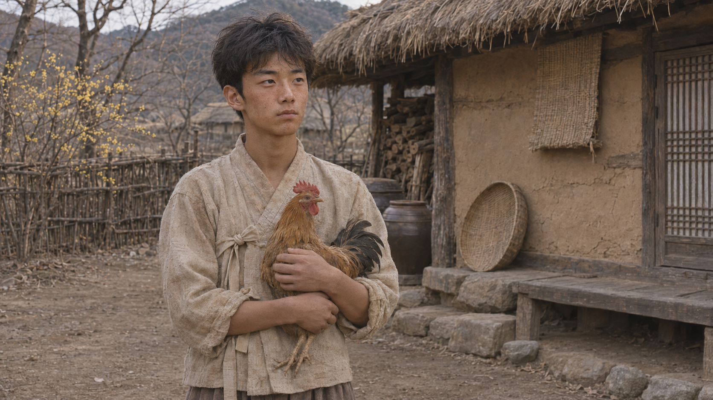

#### 영상 한글
```text
S03-01 | Flow AI | 생성 8초 / 편집 8초
1930년대 강원 농촌, 이른 봄. 16:9 시네마틱 실사, 자연광, 흙빛 색감.
시작 상태: 엄마에게 말하기 직전 — 첨부 키 이미지와 동일한 상태.
행동: 나가 작은 수탉을 안고 화면 밖 어머니에게 말한다.
카메라: 나의 미디엄 또는 클로즈업·고정. 시작 이미지와 같은 앵글, 한 번의 연속 숏, 임의 컷 전환 없음.
한국어 육성 대사: 나: 점순이가 또 싸움 붙였어.
환경음·효과음: 작은 닭 울음, 처마 밑 바람.
첫 프레임은 첨부한 S03-01.png 그대로 시작한다. 최초 선택 인물의 얼굴·머리·의상·고름·체형과 소품·광선을 유지한다. 화면에 어머니나 제3인물, 추가 손을 만들지 않는다. 어머니는 S03과 S10에서만 화면 밖 음성이다. 배경음악·설명 내레이션·화면 글자·자막·캡션·워터마크 없음. 동물 타격 접촉·상처·피 없음.
생성 길이 8초. 편집본에는 앞 8초를 사용한다. 핵심 동작과 대사는 8초 안에 끝내고 남은 시간은 종료 자세를 자연스럽게 유지한다.
```

#### Video English
```text
S03-01 | Flow AI | Generate 8s / Edit 8s
Early spring, 1930s rural Gangwon Korea. 16:9 cinematic live action, natural light, earthy palette.
START STATE: ONLY the boy visible in poor thatched farmhouse courtyard. He gently holds small golden-brown rooster against his chest, eyes directed offscreen right toward unseen mother, mouth closed BEFORE speaking. Medium shot, late afternoon. Absolutely no woman, mother, hand or silhouette in frame.
ACTION: The boy holds his small rooster and speaks to his mother OFFSCREEN.
CAMERA: Medium or close-up on the boy, locked off; maintain start-frame angle, one continuous shot, no spontaneous cuts.
Spoken ORIGINAL KOREAN, never translated: 나: 점순이가 또 싸움 붙였어.
Diegetic sounds: Soft rooster clucking, breeze under eaves.
Start exactly from the attached S03-01.png. Preserve original approved identities, hair, clothing, goreum, body builds, props and light. NO mother or third human or extra hands appears. Mothers are offscreen voices only in S03 and S10. No music, narration, on-screen text, subtitles, captions or watermark; no animal impact, wounds or blood.
Generate 8 seconds. Use the FIRST 8 seconds in the edit. Finish the essential action and dialogue within 8 seconds, then hold the final posture naturally.
```

#### 시작 이미지 프롬프트
```text
ONE single WIDE 16:9 live-action photorealistic START FRAME of an 8-second film clip. Early spring, 1930s rural Gangwon Korea, muted earth colors, unretouched skin, natural soft light, subtle film grain. Identity reference contains ONLY boy on left and girl on right: faithfully preserve their faces, bodies, original hair, original clothing and original goreum knots. Boy: short untidy black hair, faded ivory jeogori, grey-brown baji, straw sandals. Girl: round face, one black braid with dark ribbon, muted ochre jeogori, dark plum chima, black rubber shoes. Use location and prop boards only for environment/object appearance, never their layout. CRITICAL: NO MOTHER, NO ADULT WOMAN, NO THIRD HUMAN, NO bystander, NO extra hands, NO silhouette. Include only explicitly requested characters; if an isolated closeup, no other face. Image is the instant BEFORE the named action, not mid-action or its ending. No collage, no panels, no text, no captions, no logo, no modern objects, no costume redesign, no animal impact/blood/wounds. Spicebush flowers yellow, not red camellia. Hodeugi is a short straight bark tube, not a smoking pipe. START COMPOSITION: ONLY the boy visible in poor thatched farmhouse courtyard. He gently holds small golden-brown rooster against his chest, eyes directed offscreen right toward unseen mother, mouth closed BEFORE speaking. Medium shot, late afternoon. Absolutely no woman, mother, hand or silhouette in frame.
```


### S03-02 · 53–61초 · 생성8초/편집8초

시작: 엄마의 경고를 듣기 직전

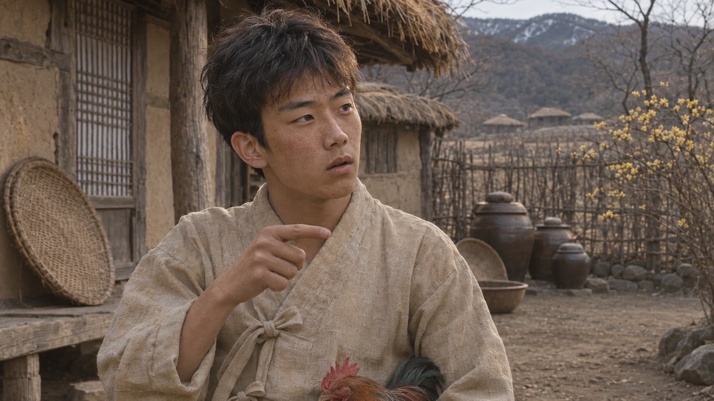

#### 영상 한글
```text
S03-02 | Flow AI | 생성 8초 / 편집 8초
1930년대 강원 농촌, 이른 봄. 16:9 시네마틱 실사, 자연광, 흙빛 색감.
시작 상태: 엄마의 경고를 듣기 직전 — 첨부 키 이미지와 동일한 상태.
행동: 나가 이웃집을 가리키던 손을 화면 밖 어머니의 경고에 스스로 내린다.
카메라: 나의 미디엄 또는 클로즈업·고정. 시작 이미지와 같은 앵글, 한 번의 연속 숏, 임의 컷 전환 없음.
한국어 육성 대사: 어머니(화면 밖 목소리): 그 집은 마름이야. 밉보이면 밭도 못 부쳐.
환경음·효과음: 작은 닭 울음, 처마 밑 바람.
첫 프레임은 첨부한 S03-02.png 그대로 시작한다. 최초 선택 인물의 얼굴·머리·의상·고름·체형과 소품·광선을 유지한다. 화면에 어머니나 제3인물, 추가 손을 만들지 않는다. 어머니는 S03과 S10에서만 화면 밖 음성이다. 배경음악·설명 내레이션·화면 글자·자막·캡션·워터마크 없음. 동물 타격 접촉·상처·피 없음.
생성 길이 8초. 편집본에는 앞 8초를 사용한다. 핵심 동작과 대사는 8초 안에 끝내고 남은 시간은 종료 자세를 자연스럽게 유지한다.
```

#### Video English
```text
S03-02 | Flow AI | Generate 8s / Edit 8s
Early spring, 1930s rural Gangwon Korea. 16:9 cinematic live action, natural light, earthy palette.
START STATE: ONLY boy closeup in same courtyard, small rooster partly visible at bottom in his arms. Boy has one hand already lifted to point toward the neighbor, listening offscreen right, BEFORE lowering his own hand at the unseen mother’s warning. Mother is VOICE ONLY, no mother body or hands anywhere. Late afternoon.
ACTION: The boy listens to his OFFSCREEN mother and lowers his own pointing hand.
CAMERA: Medium or close-up on the boy, locked off; maintain start-frame angle, one continuous shot, no spontaneous cuts.
Spoken ORIGINAL KOREAN, never translated: 어머니(화면 밖 목소리): 그 집은 마름이야. 밉보이면 밭도 못 부쳐.
Diegetic sounds: Soft rooster clucking, breeze under eaves.
Start exactly from the attached S03-02.png. Preserve original approved identities, hair, clothing, goreum, body builds, props and light. NO mother or third human or extra hands appears. Mothers are offscreen voices only in S03 and S10. No music, narration, on-screen text, subtitles, captions or watermark; no animal impact, wounds or blood.
Generate 8 seconds. Use the FIRST 8 seconds in the edit. Finish the essential action and dialogue within 8 seconds, then hold the final posture naturally.
```

#### 시작 이미지 프롬프트
```text
ONE single WIDE 16:9 live-action photorealistic START FRAME of an 8-second film clip. Early spring, 1930s rural Gangwon Korea, muted earth colors, unretouched skin, natural soft light, subtle film grain. Identity reference contains ONLY boy on left and girl on right: faithfully preserve their faces, bodies, original hair, original clothing and original goreum knots. Boy: short untidy black hair, faded ivory jeogori, grey-brown baji, straw sandals. Girl: round face, one black braid with dark ribbon, muted ochre jeogori, dark plum chima, black rubber shoes. Use location and prop boards only for environment/object appearance, never their layout. CRITICAL: NO MOTHER, NO ADULT WOMAN, NO THIRD HUMAN, NO bystander, NO extra hands, NO silhouette. Include only explicitly requested characters; if an isolated closeup, no other face. Image is the instant BEFORE the named action, not mid-action or its ending. No collage, no panels, no text, no captions, no logo, no modern objects, no costume redesign, no animal impact/blood/wounds. Spicebush flowers yellow, not red camellia. Hodeugi is a short straight bark tube, not a smoking pipe. START COMPOSITION: ONLY boy closeup in same courtyard, small rooster partly visible at bottom in his arms. Boy has one hand already lifted to point toward the neighbor, listening offscreen right, BEFORE lowering his own hand at the unseen mother’s warning. Mother is VOICE ONLY, no mother body or hands anywhere. Late afternoon.
```


### S03-03 · 61–65초 · 생성8초/편집4초

시작: 입을 다물기 직전

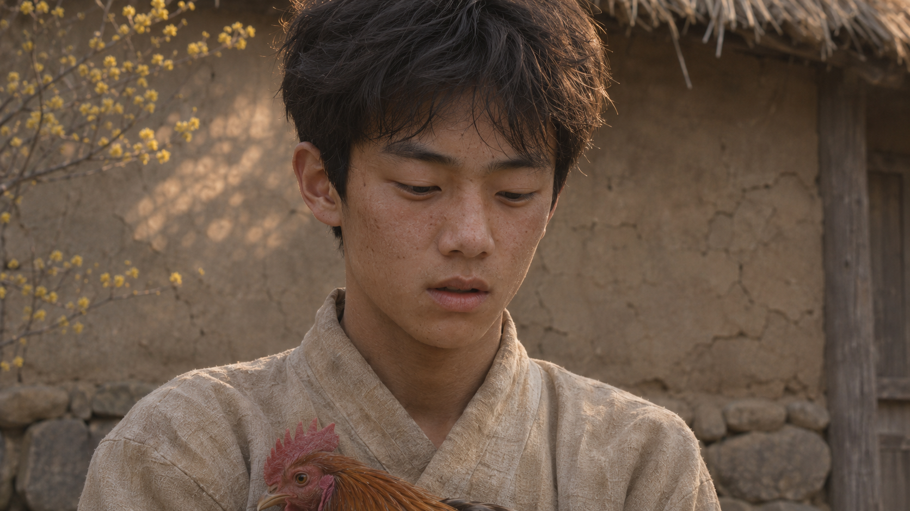

#### 영상 한글
```text
S03-03 | Flow AI | 생성 8초 / 편집 4초
1930년대 강원 농촌, 이른 봄. 16:9 시네마틱 실사, 자연광, 흙빛 색감.
시작 상태: 입을 다물기 직전 — 첨부 키 이미지와 동일한 상태.
행동: 나가 입을 다문다.
카메라: 나의 미디엄 또는 클로즈업·고정. 시작 이미지와 같은 앵글, 한 번의 연속 숏, 임의 컷 전환 없음.
대사 없음.
환경음·효과음: 작은 닭 울음, 처마 밑 바람.
첫 프레임은 첨부한 S03-03.png 그대로 시작한다. 최초 선택 인물의 얼굴·머리·의상·고름·체형과 소품·광선을 유지한다. 화면에 어머니나 제3인물, 추가 손을 만들지 않는다. 어머니는 S03과 S10에서만 화면 밖 음성이다. 배경음악·설명 내레이션·화면 글자·자막·캡션·워터마크 없음. 동물 타격 접촉·상처·피 없음.
생성 길이 8초. 편집본에는 앞 4초를 사용한다. 핵심 동작과 대사는 4초 안에 끝내고 남은 시간은 종료 자세를 자연스럽게 유지한다.
```

#### Video English
```text
S03-03 | Flow AI | Generate 8s / Edit 4s
Early spring, 1930s rural Gangwon Korea. 16:9 cinematic live action, natural light, earthy palette.
START STATE: ONLY boy face closeup, lips slightly parted and gaze lowered while holding small rooster below crop, BEFORE falling silent after offscreen mother warning. Earthen courtyard wall behind, late afternoon. No other person.
ACTION: The boy falls silent.
CAMERA: Medium or close-up on the boy, locked off; maintain start-frame angle, one continuous shot, no spontaneous cuts.
No dialogue.
Diegetic sounds: Soft rooster clucking, breeze under eaves.
Start exactly from the attached S03-03.png. Preserve original approved identities, hair, clothing, goreum, body builds, props and light. NO mother or third human or extra hands appears. Mothers are offscreen voices only in S03 and S10. No music, narration, on-screen text, subtitles, captions or watermark; no animal impact, wounds or blood.
Generate 8 seconds. Use the FIRST 4 seconds in the edit. Finish the essential action and dialogue within 4 seconds, then hold the final posture naturally.
```

#### 시작 이미지 프롬프트
```text
ONE single WIDE 16:9 live-action photorealistic START FRAME of an 8-second film clip. Early spring, 1930s rural Gangwon Korea, muted earth colors, unretouched skin, natural soft light, subtle film grain. Identity reference contains ONLY boy on left and girl on right: faithfully preserve their faces, bodies, original hair, original clothing and original goreum knots. Boy: short untidy black hair, faded ivory jeogori, grey-brown baji, straw sandals. Girl: round face, one black braid with dark ribbon, muted ochre jeogori, dark plum chima, black rubber shoes. Use location and prop boards only for environment/object appearance, never their layout. CRITICAL: NO MOTHER, NO ADULT WOMAN, NO THIRD HUMAN, NO bystander, NO extra hands, NO silhouette. Include only explicitly requested characters; if an isolated closeup, no other face. Image is the instant BEFORE the named action, not mid-action or its ending. No collage, no panels, no text, no captions, no logo, no modern objects, no costume redesign, no animal impact/blood/wounds. Spicebush flowers yellow, not red camellia. Hodeugi is a short straight bark tube, not a smoking pipe. START COMPOSITION: ONLY boy face closeup, lips slightly parted and gaze lowered while holding small rooster below crop, BEFORE falling silent after offscreen mother warning. Earthen courtyard wall behind, late afternoon. No other person.
```


## S04 고추장 — 20초

등장: 나 C01


### S04-01 · 65–73초 · 생성8초/편집8초

시작: 종지를 놓기 직전

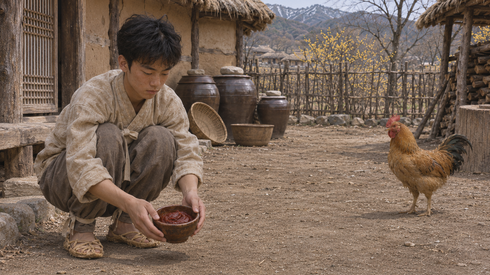

#### 영상 한글
```text
S04-01 | Flow AI | 생성 8초 / 편집 8초
1930년대 강원 농촌, 이른 봄. 16:9 시네마틱 실사, 자연광, 흙빛 색감.
시작 상태: 종지를 놓기 직전 — 첨부 키 이미지와 동일한 상태.
행동: 나가 고추장 종지를 땅에 놓는다. 나가 손가락 끝에 고추장을 묻힌다.
카메라: 종지 인서트·50mm·고정. 시작 이미지와 같은 앵글, 한 번의 연속 숏, 임의 컷 전환 없음.
대사 없음.
환경음·효과음: 질그릇이 흙에 닿는 소리 / 종지 스침.
첫 프레임은 첨부한 S04-01.png 그대로 시작한다. 최초 선택 인물의 얼굴·머리·의상·고름·체형과 소품·광선을 유지한다. 화면에 어머니나 제3인물, 추가 손을 만들지 않는다. 어머니는 S03과 S10에서만 화면 밖 음성이다. 배경음악·설명 내레이션·화면 글자·자막·캡션·워터마크 없음. 동물 타격 접촉·상처·피 없음.
생성 길이 8초. 편집본에는 앞 8초를 사용한다. 핵심 동작과 대사는 8초 안에 끝내고 남은 시간은 종료 자세를 자연스럽게 유지한다.
화면 등장: 나와 작은 수탉만. 점순이·어머니·다른 인물·지게·호드기 없음.
```

#### Video English
```text
S04-01 | Flow AI | Generate 8s / Edit 8s
Early spring, 1930s rural Gangwon Korea. 16:9 cinematic live action, natural light, earthy palette.
START STATE: ONLY boy crouched in farmhouse side yard, holding one small brown earthen bowl of gochujang just above dirt, BEFORE placing it on ground. Small golden-brown rooster stands at safe distance frame right. Low medium shot. Noon.
ACTION: The boy places the gochujang bowl on the earth. The boy dabs a tiny amount of gochujang on his fingertip.
CAMERA: Bowl insert, 50mm, locked off; maintain start-frame angle, one continuous shot, no spontaneous cuts.
No dialogue.
Diegetic sounds: Earthenware on dirt / Soft touch against bowl.
Start exactly from the attached S04-01.png. Preserve original approved identities, hair, clothing, goreum, body builds, props and light. NO mother or third human or extra hands appears. Mothers are offscreen voices only in S03 and S10. No music, narration, on-screen text, subtitles, captions or watermark; no animal impact, wounds or blood.
Generate 8 seconds. Use the FIRST 8 seconds in the edit. Finish the essential action and dialogue within 8 seconds, then hold the final posture naturally.
Only boy and small rooster visible, plus one bowl. NO Jeomsun, mother, other human, jige or whistle.
```

#### 시작 이미지 프롬프트
```text
ONE single WIDE 16:9 live-action photorealistic START FRAME of an 8-second film clip. Early spring, 1930s rural Gangwon Korea, muted earth colors, unretouched skin, natural soft light, subtle film grain. Identity reference contains ONLY boy on left and girl on right: faithfully preserve their faces, bodies, original hair, original clothing and original goreum knots. Boy: short untidy black hair, faded ivory jeogori, grey-brown baji, straw sandals. Girl: round face, one black braid with dark ribbon, muted ochre jeogori, dark plum chima, black rubber shoes. Use location and prop boards only for environment/object appearance, never their layout. CRITICAL: NO MOTHER, NO ADULT WOMAN, NO THIRD HUMAN, NO bystander, NO extra hands, NO silhouette. Include only explicitly requested characters; if an isolated closeup, no other face. Image is the instant BEFORE the named action, not mid-action or its ending. No collage, no panels, no text, no captions, no logo, no modern objects, no costume redesign, no animal impact/blood/wounds. Spicebush flowers yellow, not red camellia. Hodeugi is a short straight bark tube, not a smoking pipe. START COMPOSITION: ONLY boy crouched in farmhouse side yard, holding one small brown earthen bowl of gochujang just above dirt, BEFORE placing it on ground. Small golden-brown rooster stands at safe distance frame right. Low medium shot. Noon. STRICT PROP WHITELIST: only boy, small rooster and one earthen gochujang bowl. NO girl, NO jige carrier, NO whistle, NO potatoes, NO apron, NO extra people or hands.
```


### S04-02 · 73–81초 · 생성8초/편집8초

시작: 고추장을 내밀기 직전

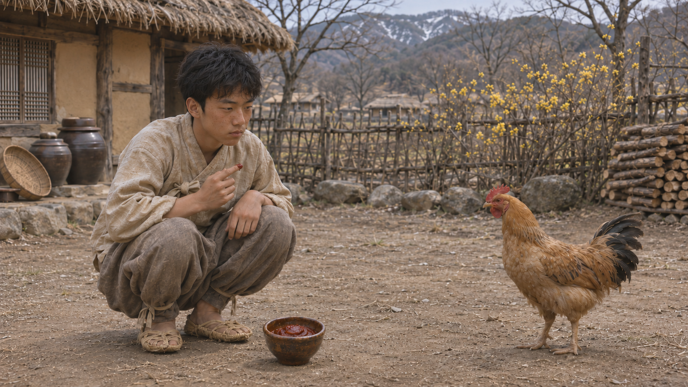

#### 영상 한글
```text
S04-02 | Flow AI | 생성 8초 / 편집 8초
1930년대 강원 농촌, 이른 봄. 16:9 시네마틱 실사, 자연광, 흙빛 색감.
시작 상태: 고추장을 내밀기 직전 — 첨부 키 이미지와 동일한 상태.
행동: 나가 닭의 부리와 떨어진 곳에 손가락을 내민다.
카메라: 로우 미디엄·50mm·고정. 시작 이미지와 같은 앵글, 한 번의 연속 숏, 임의 컷 전환 없음.
한국어 육성 대사: 나: 이거 먹으면 기운 난댔어. 이번엔 지지 마.
환경음·효과음: 가벼운 푸드덕거림.
첫 프레임은 첨부한 S04-02.png 그대로 시작한다. 최초 선택 인물의 얼굴·머리·의상·고름·체형과 소품·광선을 유지한다. 화면에 어머니나 제3인물, 추가 손을 만들지 않는다. 어머니는 S03과 S10에서만 화면 밖 음성이다. 배경음악·설명 내레이션·화면 글자·자막·캡션·워터마크 없음. 동물 타격 접촉·상처·피 없음.
생성 길이 8초. 편집본에는 앞 8초를 사용한다. 핵심 동작과 대사는 8초 안에 끝내고 남은 시간은 종료 자세를 자연스럽게 유지한다.
화면 등장: 나와 작은 수탉만. 점순이·어머니·다른 인물·지게·호드기 없음.
```

#### Video English
```text
S04-02 | Flow AI | Generate 8s / Edit 8s
Early spring, 1930s rural Gangwon Korea. 16:9 cinematic live action, natural light, earthy palette.
START STATE: ONLY boy crouching with tiny dab of gochujang on index fingertip held close to his own chest, BEFORE extending toward rooster. Small golden-brown rooster at right keeps clear distance; bowl on earth. Low medium shot. No feeding or contact. Noon.
ACTION: The boy offers his fingertip well away from the rooster’s beak; no feeding.
CAMERA: Low medium, 50mm, locked off; maintain start-frame angle, one continuous shot, no spontaneous cuts.
Spoken ORIGINAL KOREAN, never translated: 나: 이거 먹으면 기운 난댔어. 이번엔 지지 마.
Diegetic sounds: Light flapping.
Start exactly from the attached S04-02.png. Preserve original approved identities, hair, clothing, goreum, body builds, props and light. NO mother or third human or extra hands appears. Mothers are offscreen voices only in S03 and S10. No music, narration, on-screen text, subtitles, captions or watermark; no animal impact, wounds or blood.
Generate 8 seconds. Use the FIRST 8 seconds in the edit. Finish the essential action and dialogue within 8 seconds, then hold the final posture naturally.
Only boy and small rooster visible, plus one bowl. NO Jeomsun, mother, other human, jige or whistle.
```

#### 시작 이미지 프롬프트
```text
ONE single WIDE 16:9 live-action photorealistic START FRAME of an 8-second film clip. Early spring, 1930s rural Gangwon Korea, muted earth colors, unretouched skin, natural soft light, subtle film grain. Identity reference contains ONLY boy on left and girl on right: faithfully preserve their faces, bodies, original hair, original clothing and original goreum knots. Boy: short untidy black hair, faded ivory jeogori, grey-brown baji, straw sandals. Girl: round face, one black braid with dark ribbon, muted ochre jeogori, dark plum chima, black rubber shoes. Use location and prop boards only for environment/object appearance, never their layout. CRITICAL: NO MOTHER, NO ADULT WOMAN, NO THIRD HUMAN, NO bystander, NO extra hands, NO silhouette. Include only explicitly requested characters; if an isolated closeup, no other face. Image is the instant BEFORE the named action, not mid-action or its ending. No collage, no panels, no text, no captions, no logo, no modern objects, no costume redesign, no animal impact/blood/wounds. Spicebush flowers yellow, not red camellia. Hodeugi is a short straight bark tube, not a smoking pipe. START COMPOSITION: ONLY boy crouching with tiny dab of gochujang on index fingertip held close to his own chest, BEFORE extending toward rooster. Small golden-brown rooster at right keeps clear distance; bowl on earth. Low medium shot. No feeding or contact. Noon. STRICT PROP WHITELIST: only boy, small rooster and one earthen gochujang bowl. NO girl, NO jige carrier, NO whistle, NO potatoes, NO apron, NO extra people or hands.
```


### S04-03 · 81–85초 · 생성8초/편집4초

시작: 닭이 물러서기 직전

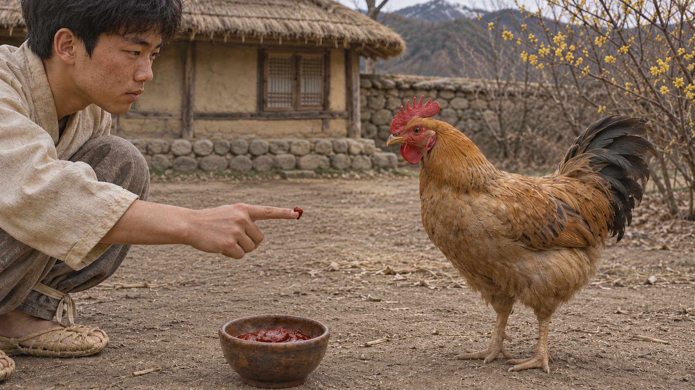

#### 영상 한글
```text
S04-03 | Flow AI | 생성 8초 / 편집 4초
1930년대 강원 농촌, 이른 봄. 16:9 시네마틱 실사, 자연광, 흙빛 색감.
시작 상태: 닭이 물러서기 직전 — 첨부 키 이미지와 동일한 상태.
행동: 작은 수탉이 뒤로 물러나자 나가 손을 멈춘다.
카메라: 같은 로우 미디엄·고정. 시작 이미지와 같은 앵글, 한 번의 연속 숏, 임의 컷 전환 없음.
대사 없음.
환경음·효과음: 닭 발소리.
첫 프레임은 첨부한 S04-03.png 그대로 시작한다. 최초 선택 인물의 얼굴·머리·의상·고름·체형과 소품·광선을 유지한다. 화면에 어머니나 제3인물, 추가 손을 만들지 않는다. 어머니는 S03과 S10에서만 화면 밖 음성이다. 배경음악·설명 내레이션·화면 글자·자막·캡션·워터마크 없음. 동물 타격 접촉·상처·피 없음.
생성 길이 8초. 편집본에는 앞 4초를 사용한다. 핵심 동작과 대사는 4초 안에 끝내고 남은 시간은 종료 자세를 자연스럽게 유지한다.
화면 등장: 나와 작은 수탉만. 점순이·어머니·다른 인물·지게·호드기 없음.
```

#### Video English
```text
S04-03 | Flow AI | Generate 8s / Edit 4s
Early spring, 1930s rural Gangwon Korea. 16:9 cinematic live action, natural light, earthy palette.
START STATE: Close low view of golden-brown rooster standing still, boy fingertip with tiny dab of gochujang safely far away at left edge, BEFORE bird steps back. One brown bowl below. No beak contact. Noon.
ACTION: The small rooster steps back and the boy stops his hand.
CAMERA: Same low medium, locked off; maintain start-frame angle, one continuous shot, no spontaneous cuts.
No dialogue.
Diegetic sounds: Rooster feet on dirt.
Start exactly from the attached S04-03.png. Preserve original approved identities, hair, clothing, goreum, body builds, props and light. NO mother or third human or extra hands appears. Mothers are offscreen voices only in S03 and S10. No music, narration, on-screen text, subtitles, captions or watermark; no animal impact, wounds or blood.
Generate 8 seconds. Use the FIRST 4 seconds in the edit. Finish the essential action and dialogue within 4 seconds, then hold the final posture naturally.
Only boy and small rooster visible, plus one bowl. NO Jeomsun, mother, other human, jige or whistle.
```

#### 시작 이미지 프롬프트
```text
ONE single WIDE 16:9 live-action photorealistic START FRAME of an 8-second film clip. Early spring, 1930s rural Gangwon Korea, muted earth colors, unretouched skin, natural soft light, subtle film grain. Identity reference contains ONLY boy on left and girl on right: faithfully preserve their faces, bodies, original hair, original clothing and original goreum knots. Boy: short untidy black hair, faded ivory jeogori, grey-brown baji, straw sandals. Girl: round face, one black braid with dark ribbon, muted ochre jeogori, dark plum chima, black rubber shoes. Use location and prop boards only for environment/object appearance, never their layout. CRITICAL: NO MOTHER, NO ADULT WOMAN, NO THIRD HUMAN, NO bystander, NO extra hands, NO silhouette. Include only explicitly requested characters; if an isolated closeup, no other face. Image is the instant BEFORE the named action, not mid-action or its ending. No collage, no panels, no text, no captions, no logo, no modern objects, no costume redesign, no animal impact/blood/wounds. Spicebush flowers yellow, not red camellia. Hodeugi is a short straight bark tube, not a smoking pipe. START COMPOSITION: Close low view of golden-brown rooster standing still, boy fingertip with tiny dab of gochujang safely far away at left edge, BEFORE bird steps back. One brown bowl below. No beak contact. Noon. STRICT PROP WHITELIST: only boy, small rooster and one earthen gochujang bowl. NO girl, NO jige carrier, NO whistle, NO potatoes, NO apron, NO extra people or hands.
```


## S05 또 진 싸움 — 25초

등장: 나 C01 / 점순이 C02


### S05-01 · 85–93초 · 생성8초/편집8초

시작: 두 닭이 대치하기 직전

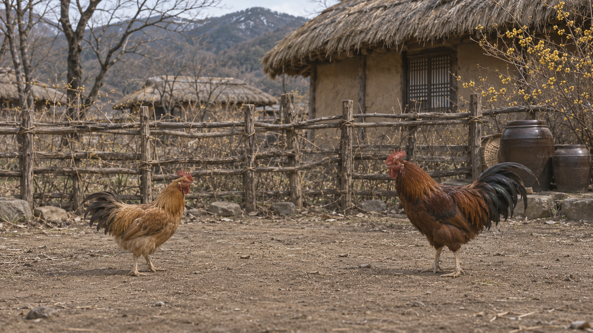

#### 영상 한글
```text
S05-01 | Flow AI | 생성 8초 / 편집 8초
1930년대 강원 농촌, 이른 봄. 16:9 시네마틱 실사, 자연광, 흙빛 색감.
시작 상태: 두 닭이 대치하기 직전 — 첨부 키 이미지와 동일한 상태.
행동: 두 수탉이 서로를 향해 목을 세운다. 큰 수탉이 날개를 펼치자 작은 수탉이 물러난다.
카메라: 로우 앵글·고정. 시작 이미지와 같은 앵글, 한 번의 연속 숏, 임의 컷 전환 없음.
대사 없음.
환경음·효과음: 닭 울음 / 날갯짓.
첫 프레임은 첨부한 S05-01.png 그대로 시작한다. 최초 선택 인물의 얼굴·머리·의상·고름·체형과 소품·광선을 유지한다. 화면에 어머니나 제3인물, 추가 손을 만들지 않는다. 어머니는 S03과 S10에서만 화면 밖 음성이다. 배경음악·설명 내레이션·화면 글자·자막·캡션·워터마크 없음. 동물 타격 접촉·상처·피 없음.
생성 길이 8초. 편집본에는 앞 8초를 사용한다. 핵심 동작과 대사는 8초 안에 끝내고 남은 시간은 종료 자세를 자연스럽게 유지한다.
```

#### Video English
```text
S05-01 | Flow AI | Generate 8s / Edit 8s
Early spring, 1930s rural Gangwon Korea. 16:9 cinematic live action, natural light, earthy palette.
START STATE: ONLY two roosters on earth before same fence, small golden-brown left, larger chestnut dark-tailed right, calm necks before raising them. No humans in crop, birds apart, no injuries. Low eye-level. Noon.
ACTION: The two roosters raise their necks toward each other without contact. The larger rooster spreads its wings as the smaller one retreats; no contact.
CAMERA: Low angle, locked off; maintain start-frame angle, one continuous shot, no spontaneous cuts.
No dialogue.
Diegetic sounds: Rooster calls / Wingbeats.
Start exactly from the attached S05-01.png. Preserve original approved identities, hair, clothing, goreum, body builds, props and light. NO mother or third human or extra hands appears. Mothers are offscreen voices only in S03 and S10. No music, narration, on-screen text, subtitles, captions or watermark; no animal impact, wounds or blood.
Generate 8 seconds. Use the FIRST 8 seconds in the edit. Finish the essential action and dialogue within 8 seconds, then hold the final posture naturally.
```

#### 시작 이미지 프롬프트
```text
ONE single WIDE 16:9 live-action photorealistic START FRAME of an 8-second film clip. Early spring, 1930s rural Gangwon Korea, muted earth colors, unretouched skin, natural soft light, subtle film grain. Identity reference contains ONLY boy on left and girl on right: faithfully preserve their faces, bodies, original hair, original clothing and original goreum knots. Boy: short untidy black hair, faded ivory jeogori, grey-brown baji, straw sandals. Girl: round face, one black braid with dark ribbon, muted ochre jeogori, dark plum chima, black rubber shoes. Use location and prop boards only for environment/object appearance, never their layout. CRITICAL: NO MOTHER, NO ADULT WOMAN, NO THIRD HUMAN, NO bystander, NO extra hands, NO silhouette. Include only explicitly requested characters; if an isolated closeup, no other face. Image is the instant BEFORE the named action, not mid-action or its ending. No collage, no panels, no text, no captions, no logo, no modern objects, no costume redesign, no animal impact/blood/wounds. Spicebush flowers yellow, not red camellia. Hodeugi is a short straight bark tube, not a smoking pipe. START COMPOSITION: ONLY two roosters on earth before same fence, small golden-brown left, larger chestnut dark-tailed right, calm necks before raising them. No humans in crop, birds apart, no injuries. Low eye-level. Noon.
```


### S05-02 · 93–101초 · 생성8초/편집8초

시작: 나가 몸을 낮추기 직전

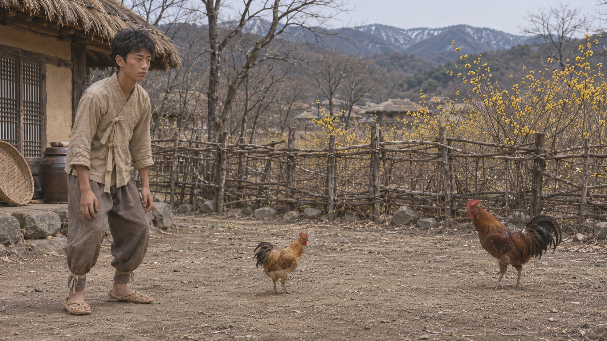

#### 영상 한글
```text
S05-02 | Flow AI | 생성 8초 / 편집 8초
1930년대 강원 농촌, 이른 봄. 16:9 시네마틱 실사, 자연광, 흙빛 색감.
시작 상태: 나가 몸을 낮추기 직전 — 첨부 키 이미지와 동일한 상태.
행동: 나가 작은 수탉 앞에 몸을 낮춘다.
카메라: 미디엄 와이드·35mm·고정. 시작 이미지와 같은 앵글, 한 번의 연속 숏, 임의 컷 전환 없음.
대사 없음.
환경음·효과음: 옷자락, 발소리.
첫 프레임은 첨부한 S05-02.png 그대로 시작한다. 최초 선택 인물의 얼굴·머리·의상·고름·체형과 소품·광선을 유지한다. 화면에 어머니나 제3인물, 추가 손을 만들지 않는다. 어머니는 S03과 S10에서만 화면 밖 음성이다. 배경음악·설명 내레이션·화면 글자·자막·캡션·워터마크 없음. 동물 타격 접촉·상처·피 없음.
생성 길이 8초. 편집본에는 앞 8초를 사용한다. 핵심 동작과 대사는 8초 안에 끝내고 남은 시간은 종료 자세를 자연스럽게 유지한다.
```

#### Video English
```text
S05-02 | Flow AI | Generate 8s / Edit 8s
Early spring, 1930s rural Gangwon Korea. 16:9 cinematic live action, natural light, earthy palette.
START STATE: Boy alone human visible frame left, standing with knees starting to bend but still upright, BEFORE crouching protectively in front of small golden-brown rooster. Larger chestnut rooster farther right, birds separate. Same fence clearing, medium-wide. Noon.
ACTION: The boy lowers himself protectively in front of the smaller rooster.
CAMERA: Medium wide, 35mm, locked off; maintain start-frame angle, one continuous shot, no spontaneous cuts.
No dialogue.
Diegetic sounds: Cloth, footsteps.
Start exactly from the attached S05-02.png. Preserve original approved identities, hair, clothing, goreum, body builds, props and light. NO mother or third human or extra hands appears. Mothers are offscreen voices only in S03 and S10. No music, narration, on-screen text, subtitles, captions or watermark; no animal impact, wounds or blood.
Generate 8 seconds. Use the FIRST 8 seconds in the edit. Finish the essential action and dialogue within 8 seconds, then hold the final posture naturally.
```

#### 시작 이미지 프롬프트
```text
ONE single WIDE 16:9 live-action photorealistic START FRAME of an 8-second film clip. Early spring, 1930s rural Gangwon Korea, muted earth colors, unretouched skin, natural soft light, subtle film grain. Identity reference contains ONLY boy on left and girl on right: faithfully preserve their faces, bodies, original hair, original clothing and original goreum knots. Boy: short untidy black hair, faded ivory jeogori, grey-brown baji, straw sandals. Girl: round face, one black braid with dark ribbon, muted ochre jeogori, dark plum chima, black rubber shoes. Use location and prop boards only for environment/object appearance, never their layout. CRITICAL: NO MOTHER, NO ADULT WOMAN, NO THIRD HUMAN, NO bystander, NO extra hands, NO silhouette. Include only explicitly requested characters; if an isolated closeup, no other face. Image is the instant BEFORE the named action, not mid-action or its ending. No collage, no panels, no text, no captions, no logo, no modern objects, no costume redesign, no animal impact/blood/wounds. Spicebush flowers yellow, not red camellia. Hodeugi is a short straight bark tube, not a smoking pipe. START COMPOSITION: Boy alone human visible frame left, standing with knees starting to bend but still upright, BEFORE crouching protectively in front of small golden-brown rooster. Larger chestnut rooster farther right, birds separate. Same fence clearing, medium-wide. Noon.
```


### S05-03 · 101–106초 · 생성8초/편집5초

시작: 점순이가 웃기 직전

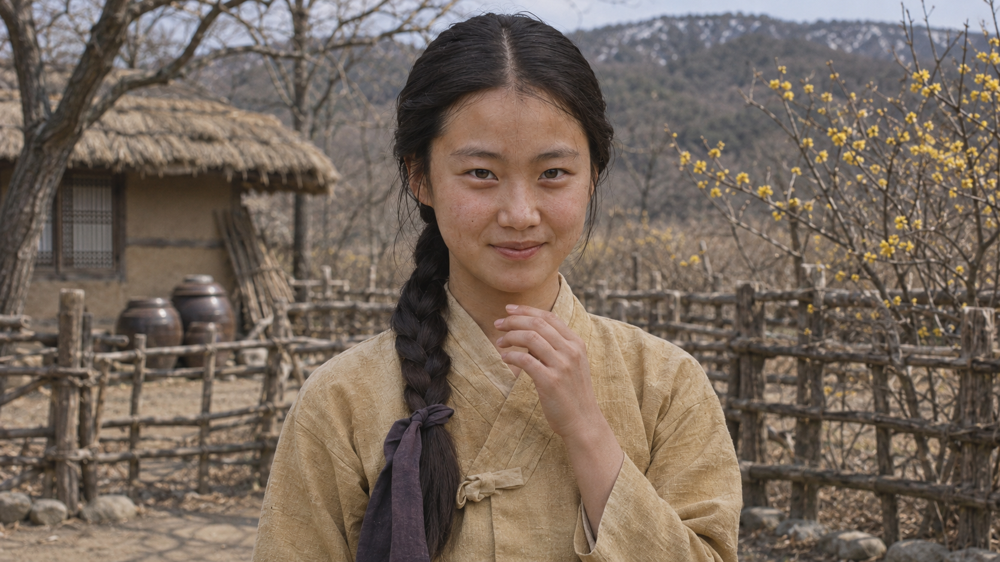

#### 영상 한글
```text
S05-03 | Flow AI | 생성 8초 / 편집 5초
1930년대 강원 농촌, 이른 봄. 16:9 시네마틱 실사, 자연광, 흙빛 색감.
시작 상태: 점순이가 웃기 직전 — 첨부 키 이미지와 동일한 상태.
행동: 점순이가 입가에 손을 댄다.
카메라: 미디엄 클로즈업·50mm·고정. 시작 이미지와 같은 앵글, 한 번의 연속 숏, 임의 컷 전환 없음.
한국어 육성 대사: 점순이: 그것 봐. 또 졌네.
환경음·효과음: 짧은 웃음.
첫 프레임은 첨부한 S05-03.png 그대로 시작한다. 최초 선택 인물의 얼굴·머리·의상·고름·체형과 소품·광선을 유지한다. 화면에 어머니나 제3인물, 추가 손을 만들지 않는다. 어머니는 S03과 S10에서만 화면 밖 음성이다. 배경음악·설명 내레이션·화면 글자·자막·캡션·워터마크 없음. 동물 타격 접촉·상처·피 없음.
생성 길이 8초. 편집본에는 앞 5초를 사용한다. 핵심 동작과 대사는 5초 안에 끝내고 남은 시간은 종료 자세를 자연스럽게 유지한다.
```

#### Video English
```text
S05-03 | Flow AI | Generate 8s / Edit 5s
Early spring, 1930s rural Gangwon Korea. 16:9 cinematic live action, natural light, earthy palette.
START STATE: Jeomsun medium closeup in fence clearing, hand lowered just below chin, restrained closed-mouth smile BEFORE raising fingertips to lips. Boy outside crop. Noon.
ACTION: Jeomsun brings her fingertips to her faint teasing smile.
CAMERA: Medium close-up, 50mm, locked off; maintain start-frame angle, one continuous shot, no spontaneous cuts.
Spoken ORIGINAL KOREAN, never translated: 점순이: 그것 봐. 또 졌네.
Diegetic sounds: Brief laugh.
Start exactly from the attached S05-03.png. Preserve original approved identities, hair, clothing, goreum, body builds, props and light. NO mother or third human or extra hands appears. Mothers are offscreen voices only in S03 and S10. No music, narration, on-screen text, subtitles, captions or watermark; no animal impact, wounds or blood.
Generate 8 seconds. Use the FIRST 5 seconds in the edit. Finish the essential action and dialogue within 5 seconds, then hold the final posture naturally.
```

#### 시작 이미지 프롬프트
```text
ONE single WIDE 16:9 live-action photorealistic START FRAME of an 8-second film clip. Early spring, 1930s rural Gangwon Korea, muted earth colors, unretouched skin, natural soft light, subtle film grain. Identity reference contains ONLY boy on left and girl on right: faithfully preserve their faces, bodies, original hair, original clothing and original goreum knots. Boy: short untidy black hair, faded ivory jeogori, grey-brown baji, straw sandals. Girl: round face, one black braid with dark ribbon, muted ochre jeogori, dark plum chima, black rubber shoes. Use location and prop boards only for environment/object appearance, never their layout. CRITICAL: NO MOTHER, NO ADULT WOMAN, NO THIRD HUMAN, NO bystander, NO extra hands, NO silhouette. Include only explicitly requested characters; if an isolated closeup, no other face. Image is the instant BEFORE the named action, not mid-action or its ending. No collage, no panels, no text, no captions, no logo, no modern objects, no costume redesign, no animal impact/blood/wounds. Spicebush flowers yellow, not red camellia. Hodeugi is a short straight bark tube, not a smoking pipe. START COMPOSITION: Jeomsun medium closeup in fence clearing, hand lowered just below chin, restrained closed-mouth smile BEFORE raising fingertips to lips. Boy outside crop. Noon.
```


### S05-04 · 106–110초 · 생성8초/편집4초

시작: 나가 올려다보기 직전

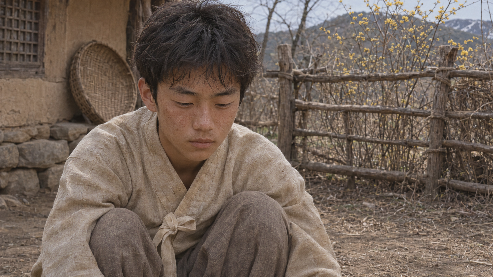

#### 영상 한글
```text
S05-04 | Flow AI | 생성 8초 / 편집 4초
1930년대 강원 농촌, 이른 봄. 16:9 시네마틱 실사, 자연광, 흙빛 색감.
시작 상태: 나가 올려다보기 직전 — 첨부 키 이미지와 동일한 상태.
행동: 나가 점순이를 올려다본다.
카메라: 나의 얼굴 클로즈업·65mm·고정. 시작 이미지와 같은 앵글, 한 번의 연속 숏, 임의 컷 전환 없음.
한국어 육성 대사: 나: 싸움 붙이지 말랬잖아!
환경음·효과음: 닭소리, 거친 숨.
첫 프레임은 첨부한 S05-04.png 그대로 시작한다. 최초 선택 인물의 얼굴·머리·의상·고름·체형과 소품·광선을 유지한다. 화면에 어머니나 제3인물, 추가 손을 만들지 않는다. 어머니는 S03과 S10에서만 화면 밖 음성이다. 배경음악·설명 내레이션·화면 글자·자막·캡션·워터마크 없음. 동물 타격 접촉·상처·피 없음.
생성 길이 8초. 편집본에는 앞 4초를 사용한다. 핵심 동작과 대사는 4초 안에 끝내고 남은 시간은 종료 자세를 자연스럽게 유지한다.
```

#### Video English
```text
S05-04 | Flow AI | Generate 8s / Edit 4s
Early spring, 1930s rural Gangwon Korea. 16:9 cinematic live action, natural light, earthy palette.
START STATE: Boy crouched in fence clearing, face closeup with eyes still lowered, BEFORE raising gaze toward Jeomsun offscreen right and protesting. Girl outside crop, no other humans. Noon.
ACTION: The crouching boy looks up sharply at Jeomsun.
CAMERA: Boy’s close-up, 65mm, locked off; maintain start-frame angle, one continuous shot, no spontaneous cuts.
Spoken ORIGINAL KOREAN, never translated: 나: 싸움 붙이지 말랬잖아!
Diegetic sounds: Roosters, tense breath.
Start exactly from the attached S05-04.png. Preserve original approved identities, hair, clothing, goreum, body builds, props and light. NO mother or third human or extra hands appears. Mothers are offscreen voices only in S03 and S10. No music, narration, on-screen text, subtitles, captions or watermark; no animal impact, wounds or blood.
Generate 8 seconds. Use the FIRST 4 seconds in the edit. Finish the essential action and dialogue within 4 seconds, then hold the final posture naturally.
```

#### 시작 이미지 프롬프트
```text
ONE single WIDE 16:9 live-action photorealistic START FRAME of an 8-second film clip. Early spring, 1930s rural Gangwon Korea, muted earth colors, unretouched skin, natural soft light, subtle film grain. Identity reference contains ONLY boy on left and girl on right: faithfully preserve their faces, bodies, original hair, original clothing and original goreum knots. Boy: short untidy black hair, faded ivory jeogori, grey-brown baji, straw sandals. Girl: round face, one black braid with dark ribbon, muted ochre jeogori, dark plum chima, black rubber shoes. Use location and prop boards only for environment/object appearance, never their layout. CRITICAL: NO MOTHER, NO ADULT WOMAN, NO THIRD HUMAN, NO bystander, NO extra hands, NO silhouette. Include only explicitly requested characters; if an isolated closeup, no other face. Image is the instant BEFORE the named action, not mid-action or its ending. No collage, no panels, no text, no captions, no logo, no modern objects, no costume redesign, no animal impact/blood/wounds. Spicebush flowers yellow, not red camellia. Hodeugi is a short straight bark tube, not a smoking pipe. START COMPOSITION: Boy crouched in fence clearing, face closeup with eyes still lowered, BEFORE raising gaze toward Jeomsun offscreen right and protesting. Girl outside crop, no other humans. Noon.
```


## S06 산길의 소리 — 20초

등장: 나 C01 / 점순이 C02(목소리)


### S06-01 · 110–118초 · 생성8초/편집8초

시작: 땔감을 얹기 직전

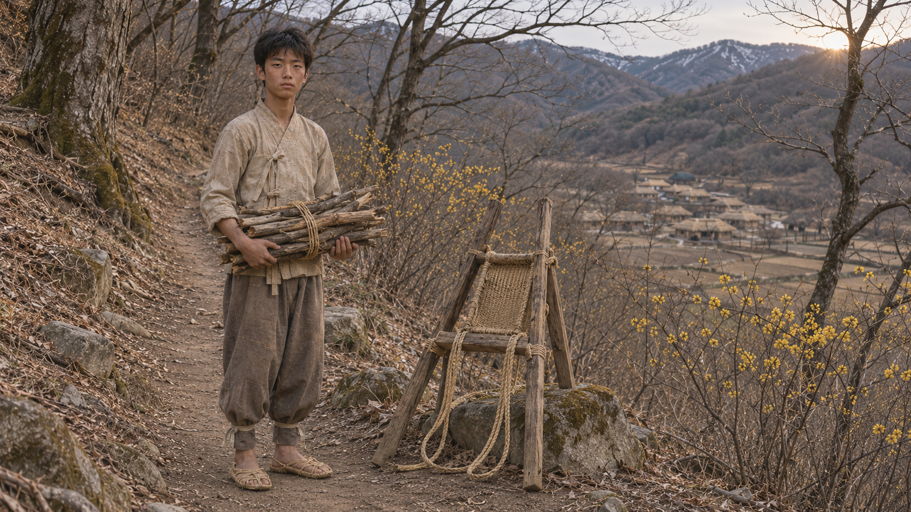

#### 영상 한글
```text
S06-01 | Flow AI | 생성 8초 / 편집 8초
1930년대 강원 농촌, 이른 봄. 16:9 시네마틱 실사, 자연광, 흙빛 색감.
시작 상태: 땔감을 얹기 직전 — 첨부 키 이미지와 동일한 상태.
행동: 나가 지게에 마른 나뭇가지를 얹는다.
카메라: 와이드·35mm·고정. 시작 이미지와 같은 앵글, 한 번의 연속 숏, 임의 컷 전환 없음.
대사 없음.
환경음·효과음: 마른 가지 마찰음.
첫 프레임은 첨부한 S06-01.png 그대로 시작한다. 최초 선택 인물의 얼굴·머리·의상·고름·체형과 소품·광선을 유지한다. 화면에 어머니나 제3인물, 추가 손을 만들지 않는다. 어머니는 S03과 S10에서만 화면 밖 음성이다. 배경음악·설명 내레이션·화면 글자·자막·캡션·워터마크 없음. 동물 타격 접촉·상처·피 없음.
생성 길이 8초. 편집본에는 앞 8초를 사용한다. 핵심 동작과 대사는 8초 안에 끝내고 남은 시간은 종료 자세를 자연스럽게 유지한다.
```

#### Video English
```text
S06-01 | Flow AI | Generate 8s / Edit 8s
Early spring, 1930s rural Gangwon Korea. 16:9 cinematic live action, natural light, earthy palette.
START STATE: ONLY boy on narrow hillside trail, holding modest dry firewood bundle at waist before loading wooden jige set beside him, rough A-frame carrier and straw ropes clearly functional. Bare early-spring trees, valley below. Wide shot, late afternoon.
ACTION: The boy lays dry firewood on his wooden jige carrier.
CAMERA: Wide, 35mm, locked off; maintain start-frame angle, one continuous shot, no spontaneous cuts.
No dialogue.
Diegetic sounds: Dry twigs rubbing.
Start exactly from the attached S06-01.png. Preserve original approved identities, hair, clothing, goreum, body builds, props and light. NO mother or third human or extra hands appears. Mothers are offscreen voices only in S03 and S10. No music, narration, on-screen text, subtitles, captions or watermark; no animal impact, wounds or blood.
Generate 8 seconds. Use the FIRST 8 seconds in the edit. Finish the essential action and dialogue within 8 seconds, then hold the final posture naturally.
```

#### 시작 이미지 프롬프트
```text
ONE single WIDE 16:9 live-action photorealistic START FRAME of an 8-second film clip. Early spring, 1930s rural Gangwon Korea, muted earth colors, unretouched skin, natural soft light, subtle film grain. Identity reference contains ONLY boy on left and girl on right: faithfully preserve their faces, bodies, original hair, original clothing and original goreum knots. Boy: short untidy black hair, faded ivory jeogori, grey-brown baji, straw sandals. Girl: round face, one black braid with dark ribbon, muted ochre jeogori, dark plum chima, black rubber shoes. Use location and prop boards only for environment/object appearance, never their layout. CRITICAL: NO MOTHER, NO ADULT WOMAN, NO THIRD HUMAN, NO bystander, NO extra hands, NO silhouette. Include only explicitly requested characters; if an isolated closeup, no other face. Image is the instant BEFORE the named action, not mid-action or its ending. No collage, no panels, no text, no captions, no logo, no modern objects, no costume redesign, no animal impact/blood/wounds. Spicebush flowers yellow, not red camellia. Hodeugi is a short straight bark tube, not a smoking pipe. START COMPOSITION: ONLY boy on narrow hillside trail, holding modest dry firewood bundle at waist before loading wooden jige set beside him, rough A-frame carrier and straw ropes clearly functional. Bare early-spring trees, valley below. Wide shot, late afternoon.
```


### S06-02 · 118–126초 · 생성8초/편집8초

시작: 소리를 듣기 직전

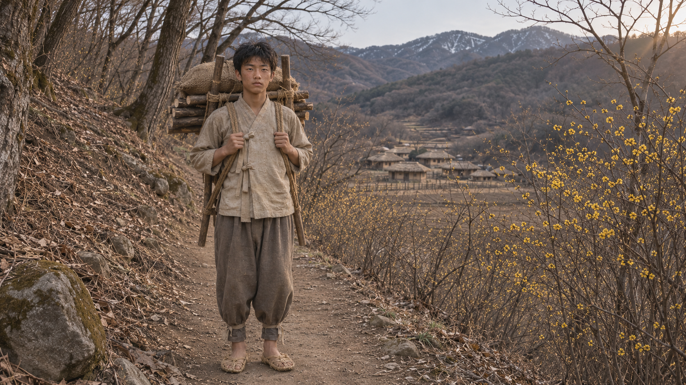

#### 영상 한글
```text
S06-02 | Flow AI | 생성 8초 / 편집 8초
1930년대 강원 농촌, 이른 봄. 16:9 시네마틱 실사, 자연광, 흙빛 색감.
시작 상태: 소리를 듣기 직전 — 첨부 키 이미지와 동일한 상태.
행동: 호드기 소리를 들은 나가 고개를 든다. 나가 지게를 내려놓는다.
카메라: 미디엄·50mm·느린 전진. 시작 이미지와 같은 앵글, 한 번의 연속 숏, 임의 컷 전환 없음.
한국어 육성 대사: 점순이(화면 밖 멀리서): 아이고, 또 밀리네.
환경음·효과음: 멀리 호드기 다음 닭 울음 / 나무가 흙에 닿음.
첫 프레임은 첨부한 S06-02.png 그대로 시작한다. 최초 선택 인물의 얼굴·머리·의상·고름·체형과 소품·광선을 유지한다. 화면에 어머니나 제3인물, 추가 손을 만들지 않는다. 어머니는 S03과 S10에서만 화면 밖 음성이다. 배경음악·설명 내레이션·화면 글자·자막·캡션·워터마크 없음. 동물 타격 접촉·상처·피 없음.
생성 길이 8초. 편집본에는 앞 8초를 사용한다. 핵심 동작과 대사는 8초 안에 끝내고 남은 시간은 종료 자세를 자연스럽게 유지한다.
```

#### Video English
```text
S06-02 | Flow AI | Generate 8s / Edit 8s
Early spring, 1930s rural Gangwon Korea. 16:9 cinematic live action, natural light, earthy palette.
START STATE: ONLY boy standing on same hillside trail with loaded wooden jige at his back/side, head still forward BEFORE hearing sound, turning head and setting carrier on ground. Medium-wide, stable posture, late afternoon. No other human or bird.
ACTION: The boy lifts his head at the distant bark-whistle sound. The boy sets the jige and firewood on the trail.
CAMERA: Medium, 50mm, slow push in; maintain start-frame angle, one continuous shot, no spontaneous cuts.
Spoken ORIGINAL KOREAN, never translated: 점순이(화면 밖 멀리서): 아이고, 또 밀리네.
Diegetic sounds: Distant bark whistle followed by rooster call / Wood touching dirt.
Start exactly from the attached S06-02.png. Preserve original approved identities, hair, clothing, goreum, body builds, props and light. NO mother or third human or extra hands appears. Mothers are offscreen voices only in S03 and S10. No music, narration, on-screen text, subtitles, captions or watermark; no animal impact, wounds or blood.
Generate 8 seconds. Use the FIRST 8 seconds in the edit. Finish the essential action and dialogue within 8 seconds, then hold the final posture naturally.
```

#### 시작 이미지 프롬프트
```text
ONE single WIDE 16:9 live-action photorealistic START FRAME of an 8-second film clip. Early spring, 1930s rural Gangwon Korea, muted earth colors, unretouched skin, natural soft light, subtle film grain. Identity reference contains ONLY boy on left and girl on right: faithfully preserve their faces, bodies, original hair, original clothing and original goreum knots. Boy: short untidy black hair, faded ivory jeogori, grey-brown baji, straw sandals. Girl: round face, one black braid with dark ribbon, muted ochre jeogori, dark plum chima, black rubber shoes. Use location and prop boards only for environment/object appearance, never their layout. CRITICAL: NO MOTHER, NO ADULT WOMAN, NO THIRD HUMAN, NO bystander, NO extra hands, NO silhouette. Include only explicitly requested characters; if an isolated closeup, no other face. Image is the instant BEFORE the named action, not mid-action or its ending. No collage, no panels, no text, no captions, no logo, no modern objects, no costume redesign, no animal impact/blood/wounds. Spicebush flowers yellow, not red camellia. Hodeugi is a short straight bark tube, not a smoking pipe. START COMPOSITION: ONLY boy standing on same hillside trail with loaded wooden jige at his back/side, head still forward BEFORE hearing sound, turning head and setting carrier on ground. Medium-wide, stable posture, late afternoon. No other human or bird.
```


### S06-03 · 126–130초 · 생성8초/편집4초

시작: 달려가기 직전

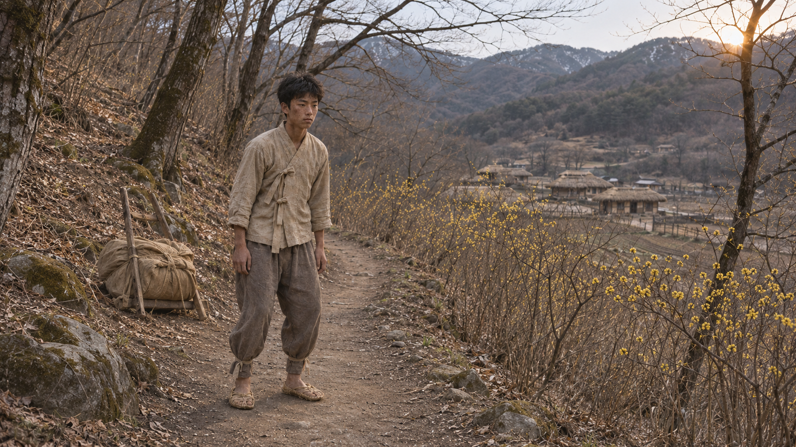

#### 영상 한글
```text
S06-03 | Flow AI | 생성 8초 / 편집 4초
1930년대 강원 농촌, 이른 봄. 16:9 시네마틱 실사, 자연광, 흙빛 색감.
시작 상태: 달려가기 직전 — 첨부 키 이미지와 동일한 상태.
행동: 나가 소리가 나는 쪽으로 달린다.
카메라: 와이드·짧은 추적 팬. 시작 이미지와 같은 앵글, 한 번의 연속 숏, 임의 컷 전환 없음.
대사 없음.
환경음·효과음: 달리는 발소리.
첫 프레임은 첨부한 S06-03.png 그대로 시작한다. 최초 선택 인물의 얼굴·머리·의상·고름·체형과 소품·광선을 유지한다. 화면에 어머니나 제3인물, 추가 손을 만들지 않는다. 어머니는 S03과 S10에서만 화면 밖 음성이다. 배경음악·설명 내레이션·화면 글자·자막·캡션·워터마크 없음. 동물 타격 접촉·상처·피 없음.
생성 길이 8초. 편집본에는 앞 4초를 사용한다. 핵심 동작과 대사는 4초 안에 끝내고 남은 시간은 종료 자세를 자연스럽게 유지한다.
```

#### Video English
```text
S06-03 | Flow AI | Generate 8s / Edit 4s
Early spring, 1930s rural Gangwon Korea. 16:9 cinematic live action, natural light, earthy palette.
START STATE: ONLY boy upright on trail, knees slightly flexed, facing downhill BEFORE beginning to run. Loaded jige stays on dirt behind him, not on back. Wide shot, late afternoon.
ACTION: The boy runs downhill toward the offscreen sound, leaving the jige behind.
CAMERA: Wide, brief tracking pan; maintain start-frame angle, one continuous shot, no spontaneous cuts.
No dialogue.
Diegetic sounds: Running footsteps.
Start exactly from the attached S06-03.png. Preserve original approved identities, hair, clothing, goreum, body builds, props and light. NO mother or third human or extra hands appears. Mothers are offscreen voices only in S03 and S10. No music, narration, on-screen text, subtitles, captions or watermark; no animal impact, wounds or blood.
Generate 8 seconds. Use the FIRST 4 seconds in the edit. Finish the essential action and dialogue within 4 seconds, then hold the final posture naturally.
```

#### 시작 이미지 프롬프트
```text
ONE single WIDE 16:9 live-action photorealistic START FRAME of an 8-second film clip. Early spring, 1930s rural Gangwon Korea, muted earth colors, unretouched skin, natural soft light, subtle film grain. Identity reference contains ONLY boy on left and girl on right: faithfully preserve their faces, bodies, original hair, original clothing and original goreum knots. Boy: short untidy black hair, faded ivory jeogori, grey-brown baji, straw sandals. Girl: round face, one black braid with dark ribbon, muted ochre jeogori, dark plum chima, black rubber shoes. Use location and prop boards only for environment/object appearance, never their layout. CRITICAL: NO MOTHER, NO ADULT WOMAN, NO THIRD HUMAN, NO bystander, NO extra hands, NO silhouette. Include only explicitly requested characters; if an isolated closeup, no other face. Image is the instant BEFORE the named action, not mid-action or its ending. No collage, no panels, no text, no captions, no logo, no modern objects, no costume redesign, no animal impact/blood/wounds. Spicebush flowers yellow, not red camellia. Hodeugi is a short straight bark tube, not a smoking pipe. START COMPOSITION: ONLY boy upright on trail, knees slightly flexed, facing downhill BEFORE beginning to run. Loaded jige stays on dirt behind him, not on back. Wide shot, late afternoon.
```


## S07 노란 꽃 아래 — 30초

등장: 나 C01 / 점순이 C02


### S07-01 · 130–138초 · 생성8초/편집8초

시작: 호드기를 떼기 직전

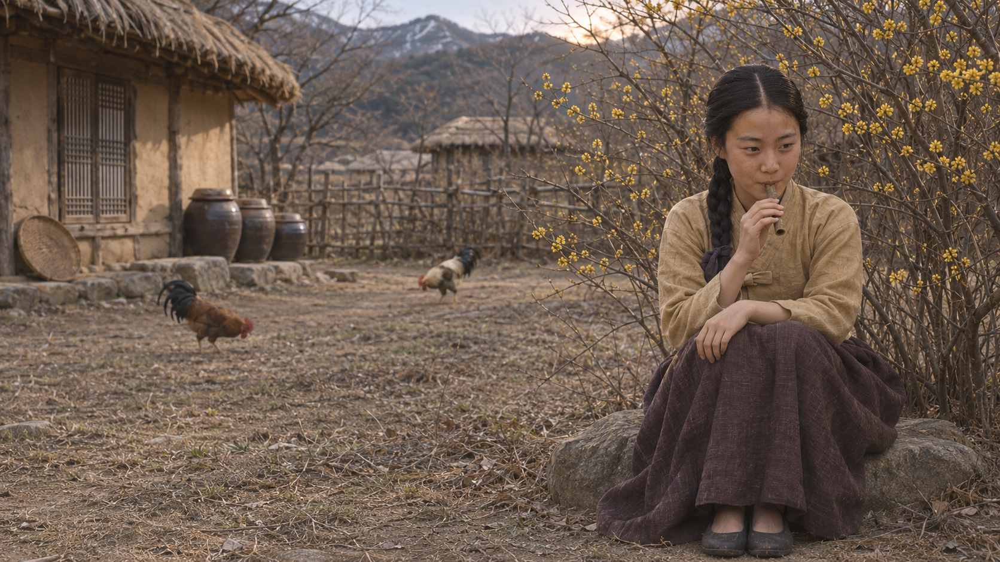

#### 영상 한글
```text
S07-01 | Flow AI | 생성 8초 / 편집 8초
1930년대 강원 농촌, 이른 봄. 16:9 시네마틱 실사, 자연광, 흙빛 색감.
시작 상태: 호드기를 떼기 직전 — 첨부 키 이미지와 동일한 상태.
행동: 점순이가 호드기를 입에서 뗀다. 작은 수탉이 큰 수탉 앞에 웅크린다.
카메라: 미디엄·50mm·고정. 시작 이미지와 같은 앵글, 한 번의 연속 숏, 임의 컷 전환 없음.
대사 없음.
환경음·효과음: 호드기 소리가 멎음 / 닭 울음.
첫 프레임은 첨부한 S07-01.png 그대로 시작한다. 최초 선택 인물의 얼굴·머리·의상·고름·체형과 소품·광선을 유지한다. 화면에 어머니나 제3인물, 추가 손을 만들지 않는다. 어머니는 S03과 S10에서만 화면 밖 음성이다. 배경음악·설명 내레이션·화면 글자·자막·캡션·워터마크 없음. 동물 타격 접촉·상처·피 없음.
생성 길이 8초. 편집본에는 앞 8초를 사용한다. 핵심 동작과 대사는 8초 안에 끝내고 남은 시간은 종료 자세를 자연스럽게 유지한다.
```

#### Video English
```text
S07-01 | Flow AI | Generate 8s / Edit 8s
Early spring, 1930s rural Gangwon Korea. 16:9 cinematic live action, natural light, earthy palette.
START STATE: ONLY Jeomsun seated frame right beside bare yellow Lindera spicebush flowers, a short STRAIGHT slender bark whistle at lips BEFORE she lowers it. Two roosters separate in middle ground, no contact. Boy outside crop. Medium-wide. Late afternoon.
ACTION: Jeomsun removes the straight bark whistle from her lips. The small rooster crouches before the larger rooster, without contact.
CAMERA: Medium, 50mm, locked off; maintain start-frame angle, one continuous shot, no spontaneous cuts.
No dialogue.
Diegetic sounds: Bark-whistle sound stops / Rooster calls.
Start exactly from the attached S07-01.png. Preserve original approved identities, hair, clothing, goreum, body builds, props and light. NO mother or third human or extra hands appears. Mothers are offscreen voices only in S03 and S10. No music, narration, on-screen text, subtitles, captions or watermark; no animal impact, wounds or blood.
Generate 8 seconds. Use the FIRST 8 seconds in the edit. Finish the essential action and dialogue within 8 seconds, then hold the final posture naturally.
```

#### 시작 이미지 프롬프트
```text
ONE single WIDE 16:9 live-action photorealistic START FRAME of an 8-second film clip. Early spring, 1930s rural Gangwon Korea, muted earth colors, unretouched skin, natural soft light, subtle film grain. Identity reference contains ONLY boy on left and girl on right: faithfully preserve their faces, bodies, original hair, original clothing and original goreum knots. Boy: short untidy black hair, faded ivory jeogori, grey-brown baji, straw sandals. Girl: round face, one black braid with dark ribbon, muted ochre jeogori, dark plum chima, black rubber shoes. Use location and prop boards only for environment/object appearance, never their layout. CRITICAL: NO MOTHER, NO ADULT WOMAN, NO THIRD HUMAN, NO bystander, NO extra hands, NO silhouette. Include only explicitly requested characters; if an isolated closeup, no other face. Image is the instant BEFORE the named action, not mid-action or its ending. No collage, no panels, no text, no captions, no logo, no modern objects, no costume redesign, no animal impact/blood/wounds. Spicebush flowers yellow, not red camellia. Hodeugi is a short straight bark tube, not a smoking pipe. START COMPOSITION: ONLY Jeomsun seated frame right beside bare yellow Lindera spicebush flowers, a short STRAIGHT slender bark whistle at lips BEFORE she lowers it. Two roosters separate in middle ground, no contact. Boy outside crop. Medium-wide. Late afternoon.
```


### S07-02 · 138–146초 · 생성8초/편집8초

시작: 빈터로 들어오기 직전

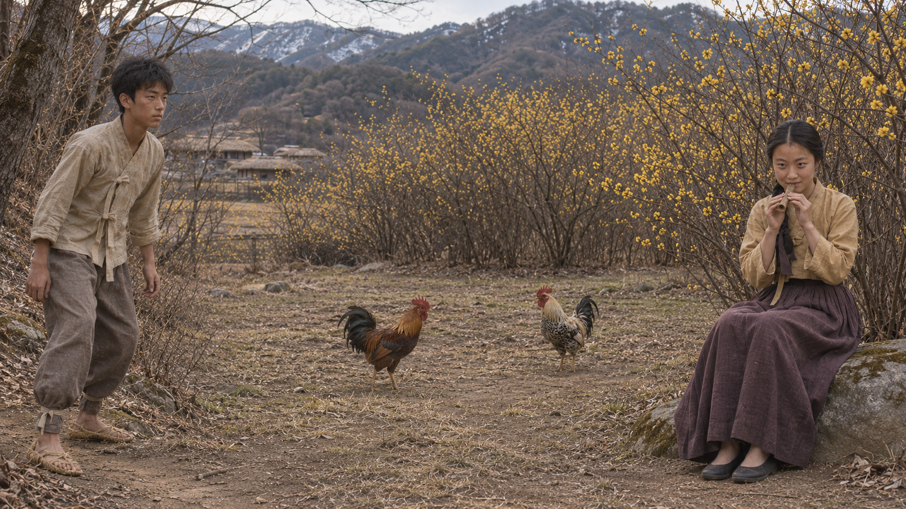

#### 영상 한글
```text
S07-02 | Flow AI | 생성 8초 / 편집 8초
1930년대 강원 농촌, 이른 봄. 16:9 시네마틱 실사, 자연광, 흙빛 색감.
시작 상태: 빈터로 들어오기 직전 — 첨부 키 이미지와 동일한 상태.
행동: 나가 빈터로 뛰어들어 점순이 앞에 멈춘다.
카메라: 미디엄 와이드·35mm·짧은 팬. 시작 이미지와 같은 앵글, 한 번의 연속 숏, 임의 컷 전환 없음.
한국어 육성 대사: 나: 내 닭 죽겠잖아!
환경음·효과음: 빠른 발소리, 거친 숨.
첫 프레임은 첨부한 S07-02.png 그대로 시작한다. 최초 선택 인물의 얼굴·머리·의상·고름·체형과 소품·광선을 유지한다. 화면에 어머니나 제3인물, 추가 손을 만들지 않는다. 어머니는 S03과 S10에서만 화면 밖 음성이다. 배경음악·설명 내레이션·화면 글자·자막·캡션·워터마크 없음. 동물 타격 접촉·상처·피 없음.
생성 길이 8초. 편집본에는 앞 8초를 사용한다. 핵심 동작과 대사는 8초 안에 끝내고 남은 시간은 종료 자세를 자연스럽게 유지한다.
```

#### Video English
```text
S07-02 | Flow AI | Generate 8s / Edit 8s
Early spring, 1930s rural Gangwon Korea. 16:9 cinematic live action, natural light, earthy palette.
START STATE: Boy at LEFT edge of yellow spicebush clearing, poised at threshold BEFORE running in. Jeomsun seated frame right, straight bark whistle held near mouth, two roosters separate on dirt between them. Wide eye-level. Late afternoon.
ACTION: The boy runs into the clearing and stops before Jeomsun.
CAMERA: Medium wide, 35mm, short pan; maintain start-frame angle, one continuous shot, no spontaneous cuts.
Spoken ORIGINAL KOREAN, never translated: 나: 내 닭 죽겠잖아!
Diegetic sounds: Quick feet, tense breath.
Start exactly from the attached S07-02.png. Preserve original approved identities, hair, clothing, goreum, body builds, props and light. NO mother or third human or extra hands appears. Mothers are offscreen voices only in S03 and S10. No music, narration, on-screen text, subtitles, captions or watermark; no animal impact, wounds or blood.
Generate 8 seconds. Use the FIRST 8 seconds in the edit. Finish the essential action and dialogue within 8 seconds, then hold the final posture naturally.
```

#### 시작 이미지 프롬프트
```text
ONE single WIDE 16:9 live-action photorealistic START FRAME of an 8-second film clip. Early spring, 1930s rural Gangwon Korea, muted earth colors, unretouched skin, natural soft light, subtle film grain. Identity reference contains ONLY boy on left and girl on right: faithfully preserve their faces, bodies, original hair, original clothing and original goreum knots. Boy: short untidy black hair, faded ivory jeogori, grey-brown baji, straw sandals. Girl: round face, one black braid with dark ribbon, muted ochre jeogori, dark plum chima, black rubber shoes. Use location and prop boards only for environment/object appearance, never their layout. CRITICAL: NO MOTHER, NO ADULT WOMAN, NO THIRD HUMAN, NO bystander, NO extra hands, NO silhouette. Include only explicitly requested characters; if an isolated closeup, no other face. Image is the instant BEFORE the named action, not mid-action or its ending. No collage, no panels, no text, no captions, no logo, no modern objects, no costume redesign, no animal impact/blood/wounds. Spicebush flowers yellow, not red camellia. Hodeugi is a short straight bark tube, not a smoking pipe. START COMPOSITION: Boy at LEFT edge of yellow spicebush clearing, poised at threshold BEFORE running in. Jeomsun seated frame right, straight bark whistle held near mouth, two roosters separate on dirt between them. Wide eye-level. Late afternoon.
```


### S07-03 · 146–154초 · 생성8초/편집8초

시작: 호드기를 내려놓기 직전

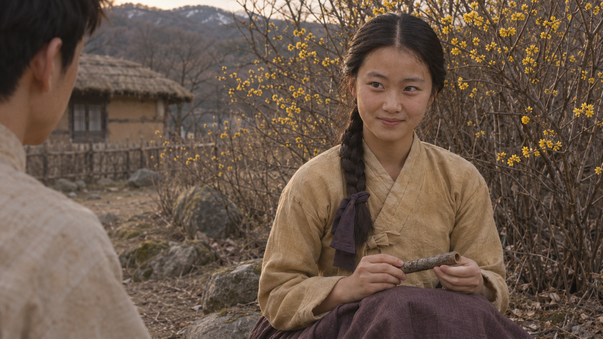

#### 영상 한글
```text
S07-03 | Flow AI | 생성 8초 / 편집 8초
1930년대 강원 농촌, 이른 봄. 16:9 시네마틱 실사, 자연광, 흙빛 색감.
시작 상태: 호드기를 내려놓기 직전 — 첨부 키 이미지와 동일한 상태.
행동: 점순이가 호드기를 무릎에 내려놓는다. 큰 수탉이 고개를 내린다. 접촉 직전에 반응 컷으로 넘긴다.
카메라: 미디엄 클로즈업·50mm·고정. 시작 이미지와 같은 앵글, 한 번의 연속 숏, 임의 컷 전환 없음.
한국어 육성 대사: 점순이: 그럼 내 말 좀 듣든가.
환경음·효과음: 옷자락, 바람 / 날갯짓.
첫 프레임은 첨부한 S07-03.png 그대로 시작한다. 최초 선택 인물의 얼굴·머리·의상·고름·체형과 소품·광선을 유지한다. 화면에 어머니나 제3인물, 추가 손을 만들지 않는다. 어머니는 S03과 S10에서만 화면 밖 음성이다. 배경음악·설명 내레이션·화면 글자·자막·캡션·워터마크 없음. 동물 타격 접촉·상처·피 없음.
생성 길이 8초. 편집본에는 앞 8초를 사용한다. 핵심 동작과 대사는 8초 안에 끝내고 남은 시간은 종료 자세를 자연스럽게 유지한다.
```

#### Video English
```text
S07-03 | Flow AI | Generate 8s / Edit 8s
Early spring, 1930s rural Gangwon Korea. 16:9 cinematic live action, natural light, earthy palette.
START STATE: Jeomsun seated medium closeup at right by yellow blossoms, holding straight bark whistle just above lap BEFORE lowering it and replying. Boy’s ivory shoulder softly at left edge, birds outside crop. Late afternoon.
ACTION: Jeomsun lowers the straight bark whistle to her lap. The larger rooster lowers its head; cut away before any contact.
CAMERA: Medium close-up, 50mm, locked off; maintain start-frame angle, one continuous shot, no spontaneous cuts.
Spoken ORIGINAL KOREAN, never translated: 점순이: 그럼 내 말 좀 듣든가.
Diegetic sounds: Cloth, breeze / Wingbeats.
Start exactly from the attached S07-03.png. Preserve original approved identities, hair, clothing, goreum, body builds, props and light. NO mother or third human or extra hands appears. Mothers are offscreen voices only in S03 and S10. No music, narration, on-screen text, subtitles, captions or watermark; no animal impact, wounds or blood.
Generate 8 seconds. Use the FIRST 8 seconds in the edit. Finish the essential action and dialogue within 8 seconds, then hold the final posture naturally.
```

#### 시작 이미지 프롬프트
```text
ONE single WIDE 16:9 live-action photorealistic START FRAME of an 8-second film clip. Early spring, 1930s rural Gangwon Korea, muted earth colors, unretouched skin, natural soft light, subtle film grain. Identity reference contains ONLY boy on left and girl on right: faithfully preserve their faces, bodies, original hair, original clothing and original goreum knots. Boy: short untidy black hair, faded ivory jeogori, grey-brown baji, straw sandals. Girl: round face, one black braid with dark ribbon, muted ochre jeogori, dark plum chima, black rubber shoes. Use location and prop boards only for environment/object appearance, never their layout. CRITICAL: NO MOTHER, NO ADULT WOMAN, NO THIRD HUMAN, NO bystander, NO extra hands, NO silhouette. Include only explicitly requested characters; if an isolated closeup, no other face. Image is the instant BEFORE the named action, not mid-action or its ending. No collage, no panels, no text, no captions, no logo, no modern objects, no costume redesign, no animal impact/blood/wounds. Spicebush flowers yellow, not red camellia. Hodeugi is a short straight bark tube, not a smoking pipe. START COMPOSITION: Jeomsun seated medium closeup at right by yellow blossoms, holding straight bark whistle just above lap BEFORE lowering it and replying. Boy’s ivory shoulder softly at left edge, birds outside crop. Late afternoon.
```


### S07-04 · 154–160초 · 생성8초/편집6초

시작: 가지를 집기 직전

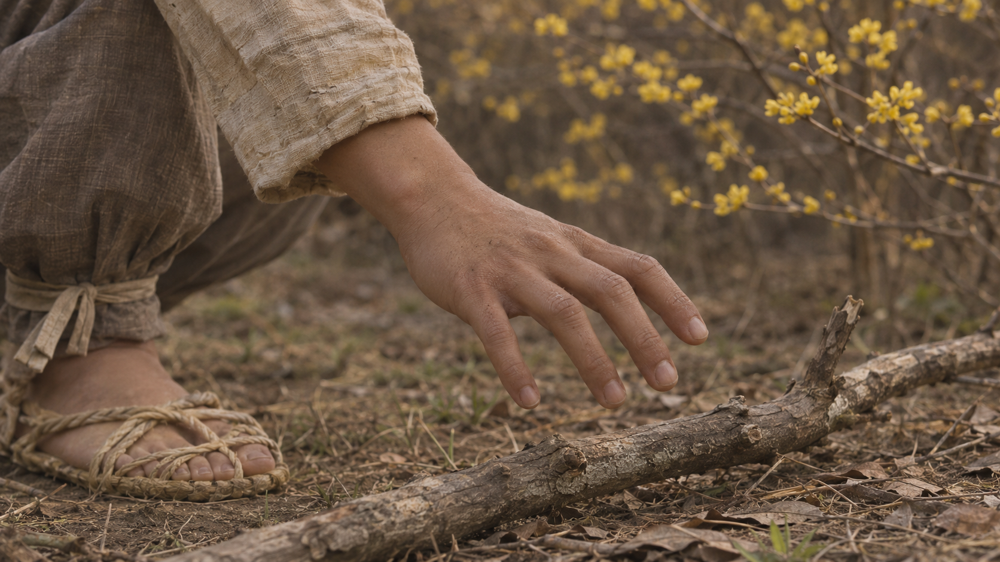

#### 영상 한글
```text
S07-04 | Flow AI | 생성 8초 / 편집 6초
1930년대 강원 농촌, 이른 봄. 16:9 시네마틱 실사, 자연광, 흙빛 색감.
시작 상태: 가지를 집기 직전 — 첨부 키 이미지와 동일한 상태.
행동: 나가 땅의 나뭇가지를 움켜쥔다.
카메라: 손 클로즈업·65mm·고정. 시작 이미지와 같은 앵글, 한 번의 연속 숏, 임의 컷 전환 없음.
대사 없음.
환경음·효과음: 손과 나무의 마찰.
첫 프레임은 첨부한 S07-04.png 그대로 시작한다. 최초 선택 인물의 얼굴·머리·의상·고름·체형과 소품·광선을 유지한다. 화면에 어머니나 제3인물, 추가 손을 만들지 않는다. 어머니는 S03과 S10에서만 화면 밖 음성이다. 배경음악·설명 내레이션·화면 글자·자막·캡션·워터마크 없음. 동물 타격 접촉·상처·피 없음.
생성 길이 8초. 편집본에는 앞 6초를 사용한다. 핵심 동작과 대사는 6초 안에 끝내고 남은 시간은 종료 자세를 자연스럽게 유지한다.
```

#### Video English
```text
S07-04 | Flow AI | Generate 8s / Edit 6s
Early spring, 1930s rural Gangwon Korea. 16:9 cinematic live action, natural light, earthy palette.
START STATE: Closeup boy’s empty hand hovering open above ONE rough fallen wooden branch on earth BEFORE grasping. Original ivory sleeve, yellow spicebush blurred in background. No birds or other hands. Late afternoon.
ACTION: The boy grips the single rough branch on the ground.
CAMERA: Hand close-up, 65mm, locked off; maintain start-frame angle, one continuous shot, no spontaneous cuts.
No dialogue.
Diegetic sounds: Hand gripping rough wood.
Start exactly from the attached S07-04.png. Preserve original approved identities, hair, clothing, goreum, body builds, props and light. NO mother or third human or extra hands appears. Mothers are offscreen voices only in S03 and S10. No music, narration, on-screen text, subtitles, captions or watermark; no animal impact, wounds or blood.
Generate 8 seconds. Use the FIRST 6 seconds in the edit. Finish the essential action and dialogue within 6 seconds, then hold the final posture naturally.
```

#### 시작 이미지 프롬프트
```text
ONE single WIDE 16:9 live-action photorealistic START FRAME of an 8-second film clip. Early spring, 1930s rural Gangwon Korea, muted earth colors, unretouched skin, natural soft light, subtle film grain. Identity reference contains ONLY boy on left and girl on right: faithfully preserve their faces, bodies, original hair, original clothing and original goreum knots. Boy: short untidy black hair, faded ivory jeogori, grey-brown baji, straw sandals. Girl: round face, one black braid with dark ribbon, muted ochre jeogori, dark plum chima, black rubber shoes. Use location and prop boards only for environment/object appearance, never their layout. CRITICAL: NO MOTHER, NO ADULT WOMAN, NO THIRD HUMAN, NO bystander, NO extra hands, NO silhouette. Include only explicitly requested characters; if an isolated closeup, no other face. Image is the instant BEFORE the named action, not mid-action or its ending. No collage, no panels, no text, no captions, no logo, no modern objects, no costume redesign, no animal impact/blood/wounds. Spicebush flowers yellow, not red camellia. Hodeugi is a short straight bark tube, not a smoking pipe. START COMPOSITION: Closeup boy’s empty hand hovering open above ONE rough fallen wooden branch on earth BEFORE grasping. Original ivory sleeve, yellow spicebush blurred in background. No birds or other hands. Late afternoon.
```


## S08 멎은 날갯짓 — 20초

등장: 나 C01 / 점순이 C02


### S08-01 · 160–168초 · 생성8초/편집8초

시작: 가지를 휘두르기 직전

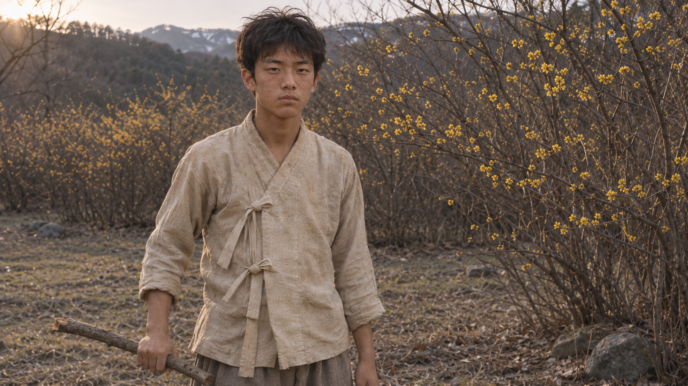

#### 영상 한글
```text
S08-01 | Flow AI | 생성 8초 / 편집 8초
1930년대 강원 농촌, 이른 봄. 16:9 시네마틱 실사, 자연광, 흙빛 색감.
시작 상태: 가지를 휘두르기 직전 — 첨부 키 이미지와 동일한 상태.
행동: 나가 나뭇가지를 휘두른다. 닭은 프레임 밖에 둔다.
카메라: 허리 위 미디엄·고정. 시작 이미지와 같은 앵글, 한 번의 연속 숏, 임의 컷 전환 없음.
대사 없음.
환경음·효과음: 옷자락과 공기 가르는 소리.
첫 프레임은 첨부한 S08-01.png 그대로 시작한다. 최초 선택 인물의 얼굴·머리·의상·고름·체형과 소품·광선을 유지한다. 화면에 어머니나 제3인물, 추가 손을 만들지 않는다. 어머니는 S03과 S10에서만 화면 밖 음성이다. 배경음악·설명 내레이션·화면 글자·자막·캡션·워터마크 없음. 동물 타격 접촉·상처·피 없음.
생성 길이 8초. 편집본에는 앞 8초를 사용한다. 핵심 동작과 대사는 8초 안에 끝내고 남은 시간은 종료 자세를 자연스럽게 유지한다.
```

#### Video English
```text
S08-01 | Flow AI | Generate 8s / Edit 8s
Early spring, 1930s rural Gangwon Korea. 16:9 cinematic live action, natural light, earthy palette.
START STATE: ONLY boy waist-up medium shot in yellow spicebush clearing, holding one rough branch LOW near his hip, tense shoulders, BEFORE swinging it. ALL birds completely offscreen. Girl outside crop. No strike, no blood. Late afternoon.
ACTION: The boy swings the branch; all animals remain outside the frame.
CAMERA: Waist-up medium, locked off; maintain start-frame angle, one continuous shot, no spontaneous cuts.
No dialogue.
Diegetic sounds: Cloth, branch whoosh.
Start exactly from the attached S08-01.png. Preserve original approved identities, hair, clothing, goreum, body builds, props and light. NO mother or third human or extra hands appears. Mothers are offscreen voices only in S03 and S10. No music, narration, on-screen text, subtitles, captions or watermark; no animal impact, wounds or blood.
Generate 8 seconds. Use the FIRST 8 seconds in the edit. Finish the essential action and dialogue within 8 seconds, then hold the final posture naturally.
```

#### 시작 이미지 프롬프트
```text
ONE single WIDE 16:9 live-action photorealistic START FRAME of an 8-second film clip. Early spring, 1930s rural Gangwon Korea, muted earth colors, unretouched skin, natural soft light, subtle film grain. Identity reference contains ONLY boy on left and girl on right: faithfully preserve their faces, bodies, original hair, original clothing and original goreum knots. Boy: short untidy black hair, faded ivory jeogori, grey-brown baji, straw sandals. Girl: round face, one black braid with dark ribbon, muted ochre jeogori, dark plum chima, black rubber shoes. Use location and prop boards only for environment/object appearance, never their layout. CRITICAL: NO MOTHER, NO ADULT WOMAN, NO THIRD HUMAN, NO bystander, NO extra hands, NO silhouette. Include only explicitly requested characters; if an isolated closeup, no other face. Image is the instant BEFORE the named action, not mid-action or its ending. No collage, no panels, no text, no captions, no logo, no modern objects, no costume redesign, no animal impact/blood/wounds. Spicebush flowers yellow, not red camellia. Hodeugi is a short straight bark tube, not a smoking pipe. START COMPOSITION: ONLY boy waist-up medium shot in yellow spicebush clearing, holding one rough branch LOW near his hip, tense shoulders, BEFORE swinging it. ALL birds completely offscreen. Girl outside crop. No strike, no blood. Late afternoon.
```


### S08-02 · 168–176초 · 생성8초/편집8초

시작: 타격음을 듣기 직전

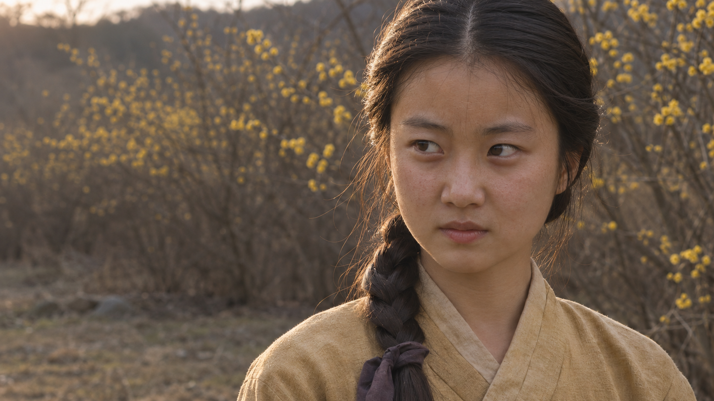

#### 영상 한글
```text
S08-02 | Flow AI | 생성 8초 / 편집 8초
1930년대 강원 농촌, 이른 봄. 16:9 시네마틱 실사, 자연광, 흙빛 색감.
시작 상태: 타격음을 듣기 직전 — 첨부 키 이미지와 동일한 상태.
행동: 점순이의 얼굴이 굳는다. 화면 밖에서 둔탁한 소리가 한 번 난다.
카메라: 점순이 클로즈업·65mm·고정. 시작 이미지와 같은 앵글, 한 번의 연속 숏, 임의 컷 전환 없음.
한국어 육성 대사: 점순이: 너, 우리 닭 죽였지?
환경음·효과음: 화면 밖 둔탁한 소리 한 번.
첫 프레임은 첨부한 S08-02.png 그대로 시작한다. 최초 선택 인물의 얼굴·머리·의상·고름·체형과 소품·광선을 유지한다. 화면에 어머니나 제3인물, 추가 손을 만들지 않는다. 어머니는 S03과 S10에서만 화면 밖 음성이다. 배경음악·설명 내레이션·화면 글자·자막·캡션·워터마크 없음. 동물 타격 접촉·상처·피 없음.
생성 길이 8초. 편집본에는 앞 8초를 사용한다. 핵심 동작과 대사는 8초 안에 끝내고 남은 시간은 종료 자세를 자연스럽게 유지한다.
```

#### Video English
```text
S08-02 | Flow AI | Generate 8s / Edit 8s
Early spring, 1930s rural Gangwon Korea. 16:9 cinematic live action, natural light, earthy palette.
START STATE: ONLY Jeomsun face closeup, eyes directed offscreen LEFT, expression tense but not yet startled, BEFORE hearing one offscreen dull sound. Original braid, ribbon, ochre jacket. Yellow blossoms softly behind. No weapon or birds in frame. Late afternoon.
ACTION: Jeomsun’s face becomes still; one dull sound occurs offscreen, no impact shown.
CAMERA: Jeomsun close-up, 65mm, locked off; maintain start-frame angle, one continuous shot, no spontaneous cuts.
Spoken ORIGINAL KOREAN, never translated: 점순이: 너, 우리 닭 죽였지?
Diegetic sounds: One dull offscreen sound.
Start exactly from the attached S08-02.png. Preserve original approved identities, hair, clothing, goreum, body builds, props and light. NO mother or third human or extra hands appears. Mothers are offscreen voices only in S03 and S10. No music, narration, on-screen text, subtitles, captions or watermark; no animal impact, wounds or blood.
Generate 8 seconds. Use the FIRST 8 seconds in the edit. Finish the essential action and dialogue within 8 seconds, then hold the final posture naturally.
```

#### 시작 이미지 프롬프트
```text
ONE single WIDE 16:9 live-action photorealistic START FRAME of an 8-second film clip. Early spring, 1930s rural Gangwon Korea, muted earth colors, unretouched skin, natural soft light, subtle film grain. Identity reference contains ONLY boy on left and girl on right: faithfully preserve their faces, bodies, original hair, original clothing and original goreum knots. Boy: short untidy black hair, faded ivory jeogori, grey-brown baji, straw sandals. Girl: round face, one black braid with dark ribbon, muted ochre jeogori, dark plum chima, black rubber shoes. Use location and prop boards only for environment/object appearance, never their layout. CRITICAL: NO MOTHER, NO ADULT WOMAN, NO THIRD HUMAN, NO bystander, NO extra hands, NO silhouette. Include only explicitly requested characters; if an isolated closeup, no other face. Image is the instant BEFORE the named action, not mid-action or its ending. No collage, no panels, no text, no captions, no logo, no modern objects, no costume redesign, no animal impact/blood/wounds. Spicebush flowers yellow, not red camellia. Hodeugi is a short straight bark tube, not a smoking pipe. START COMPOSITION: ONLY Jeomsun face closeup, eyes directed offscreen LEFT, expression tense but not yet startled, BEFORE hearing one offscreen dull sound. Original braid, ribbon, ochre jacket. Yellow blossoms softly behind. No weapon or birds in frame. Late afternoon.
```


### S08-03 · 176–180초 · 생성8초/편집4초

시작: 가지를 놓치기 직전

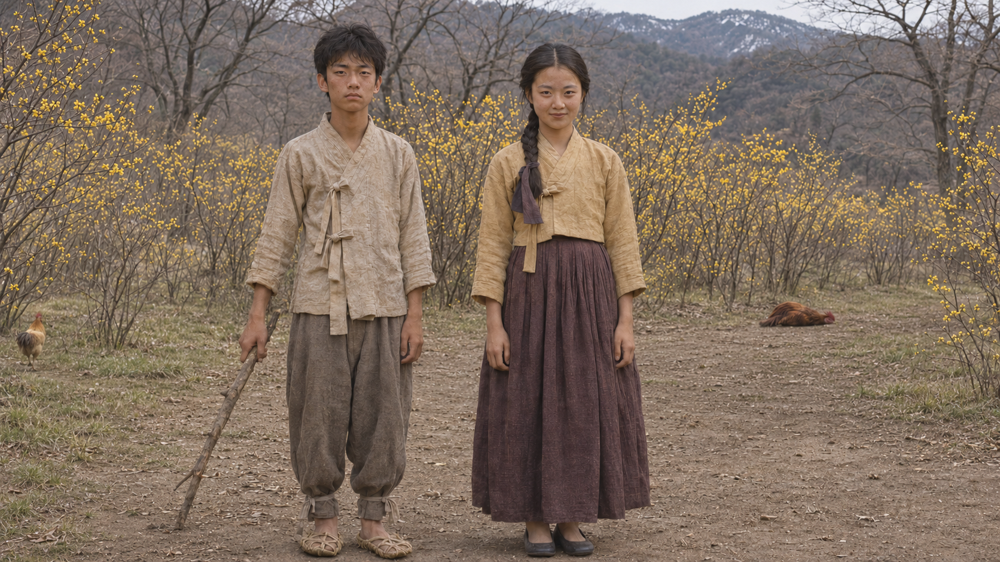

#### 영상 한글
```text
S08-03 | Flow AI | 생성 8초 / 편집 4초
1930년대 강원 농촌, 이른 봄. 16:9 시네마틱 실사, 자연광, 흙빛 색감.
시작 상태: 가지를 놓치기 직전 — 첨부 키 이미지와 동일한 상태.
행동: 나가 가지를 떨어뜨린다. 작은 수탉이 빈터 밖으로 달아난다. 큰 수탉은 먼 배경에 정지해 있다.
카메라: 와이드 투숏·눈높이·35mm·고정. 시작 이미지와 같은 앵글, 한 번의 연속 숏, 임의 컷 전환 없음.
대사 없음.
환경음·효과음: 가지 낙하음.
첫 프레임은 첨부한 S08-03.png 그대로 시작한다. 최초 선택 인물의 얼굴·머리·의상·고름·체형과 소품·광선을 유지한다. 화면에 어머니나 제3인물, 추가 손을 만들지 않는다. 어머니는 S03과 S10에서만 화면 밖 음성이다. 배경음악·설명 내레이션·화면 글자·자막·캡션·워터마크 없음. 동물 타격 접촉·상처·피 없음.
생성 길이 8초. 편집본에는 앞 4초를 사용한다. 핵심 동작과 대사는 4초 안에 끝내고 남은 시간은 종료 자세를 자연스럽게 유지한다.
```

#### Video English
```text
S08-03 | Flow AI | Generate 8s / Edit 4s
Early spring, 1930s rural Gangwon Korea. 16:9 cinematic live action, natural light, earthy palette.
START STATE: Wide eye-level two-shot in the yellow grove: boy left STILL HOLDING rough branch low at his side BEFORE dropping it; girl right watches. Small golden-brown rooster at far background edge poised to leave, larger chestnut rooster lies still far away unobtrusively on dirt, no wounds or blood. Yellow shrubs. No mother.
ACTION: The boy lets the branch drop. The small rooster exits. The larger rooster remains motionless in the distant background, no wounds or blood.
CAMERA: Wide two-shot, eye level, 35mm, locked off; maintain start-frame angle, one continuous shot, no spontaneous cuts.
No dialogue.
Diegetic sounds: Branch dropping.
Start exactly from the attached S08-03.png. Preserve original approved identities, hair, clothing, goreum, body builds, props and light. NO mother or third human or extra hands appears. Mothers are offscreen voices only in S03 and S10. No music, narration, on-screen text, subtitles, captions or watermark; no animal impact, wounds or blood.
Generate 8 seconds. Use the FIRST 4 seconds in the edit. Finish the essential action and dialogue within 4 seconds, then hold the final posture naturally.
```

#### 시작 이미지 프롬프트
```text
ONE single WIDE 16:9 live-action photorealistic START FRAME of an 8-second film clip. Early spring, 1930s rural Gangwon Korea, muted earth colors, unretouched skin, natural soft light, subtle film grain. Identity reference contains ONLY boy on left and girl on right: faithfully preserve their faces, bodies, original hair, original clothing and original goreum knots. Boy: short untidy black hair, faded ivory jeogori, grey-brown baji, straw sandals. Girl: round face, one black braid with dark ribbon, muted ochre jeogori, dark plum chima, black rubber shoes. Use location and prop boards only for environment/object appearance, never their layout. CRITICAL: NO MOTHER, NO ADULT WOMAN, NO THIRD HUMAN, NO bystander, NO extra hands, NO silhouette. Include only explicitly requested characters; if an isolated closeup, no other face. Image is the instant BEFORE the named action, not mid-action or its ending. No collage, no panels, no text, no captions, no logo, no modern objects, no costume redesign, no animal impact/blood/wounds. Spicebush flowers yellow, not red camellia. Hodeugi is a short straight bark tube, not a smoking pipe. START COMPOSITION: Wide eye-level two-shot in the yellow grove: boy left STILL HOLDING rough branch low at his side BEFORE dropping it; girl right watches. Small golden-brown rooster at far background edge poised to leave, larger chestnut rooster lies still far away unobtrusively on dirt, no wounds or blood. Yellow shrubs. No mother.
```


## S09 말하지 않을게 — 30초

등장: 나 C01 / 점순이 C02


### S09-01 · 180–188초 · 생성8초/편집8초

시작: 눈물이 흐르기 직전

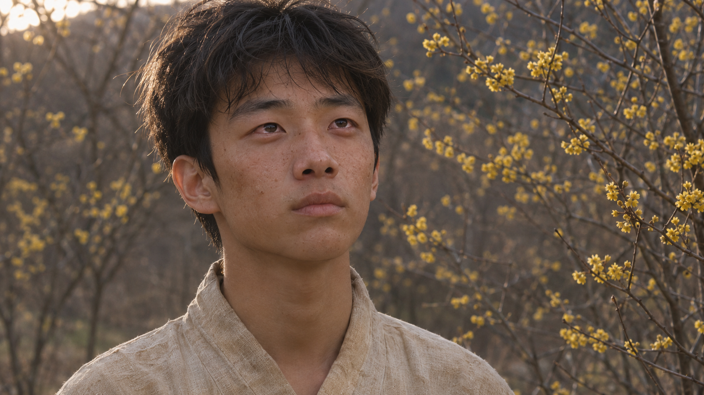

#### 영상 한글
```text
S09-01 | Flow AI | 생성 8초 / 편집 8초
1930년대 강원 농촌, 이른 봄. 16:9 시네마틱 실사, 자연광, 흙빛 색감.
시작 상태: 눈물이 흐르기 직전 — 첨부 키 이미지와 동일한 상태.
행동: 나가 점순이를 올려다본다. 나의 눈에 눈물이 흐른다.
카메라: 나의 얼굴 클로즈업·65mm·고정. 시작 이미지와 같은 앵글, 한 번의 연속 숏, 임의 컷 전환 없음.
한국어 육성 대사: 나: 너희 집에서 우리 밭 뺏으면… 우린 어떡해.
환경음·효과음: 떨리는 숨 / 훌쩍임.
첫 프레임은 첨부한 S09-01.png 그대로 시작한다. 최초 선택 인물의 얼굴·머리·의상·고름·체형과 소품·광선을 유지한다. 화면에 어머니나 제3인물, 추가 손을 만들지 않는다. 어머니는 S03과 S10에서만 화면 밖 음성이다. 배경음악·설명 내레이션·화면 글자·자막·캡션·워터마크 없음. 동물 타격 접촉·상처·피 없음.
생성 길이 8초. 편집본에는 앞 8초를 사용한다. 핵심 동작과 대사는 8초 안에 끝내고 남은 시간은 종료 자세를 자연스럽게 유지한다.
```

#### Video English
```text
S09-01 | Flow AI | Generate 8s / Edit 8s
Early spring, 1930s rural Gangwon Korea. 16:9 cinematic live action, natural light, earthy palette.
START STATE: ONLY boy face closeup in yellow grove, eyes moist but no flowing tears yet, looking slightly upward toward unseen Jeomsun, lips closed BEFORE speaking. Ivory collar, original face. Late afternoon.
ACTION: The boy looks up at Jeomsun. Tears run down the boy’s face.
CAMERA: Boy’s close-up, 65mm, locked off; maintain start-frame angle, one continuous shot, no spontaneous cuts.
Spoken ORIGINAL KOREAN, never translated: 나: 너희 집에서 우리 밭 뺏으면… 우린 어떡해.
Diegetic sounds: Trembling breath / Sniffling.
Start exactly from the attached S09-01.png. Preserve original approved identities, hair, clothing, goreum, body builds, props and light. NO mother or third human or extra hands appears. Mothers are offscreen voices only in S03 and S10. No music, narration, on-screen text, subtitles, captions or watermark; no animal impact, wounds or blood.
Generate 8 seconds. Use the FIRST 8 seconds in the edit. Finish the essential action and dialogue within 8 seconds, then hold the final posture naturally.
```

#### 시작 이미지 프롬프트
```text
ONE single WIDE 16:9 live-action photorealistic START FRAME of an 8-second film clip. Early spring, 1930s rural Gangwon Korea, muted earth colors, unretouched skin, natural soft light, subtle film grain. Identity reference contains ONLY boy on left and girl on right: faithfully preserve their faces, bodies, original hair, original clothing and original goreum knots. Boy: short untidy black hair, faded ivory jeogori, grey-brown baji, straw sandals. Girl: round face, one black braid with dark ribbon, muted ochre jeogori, dark plum chima, black rubber shoes. Use location and prop boards only for environment/object appearance, never their layout. CRITICAL: NO MOTHER, NO ADULT WOMAN, NO THIRD HUMAN, NO bystander, NO extra hands, NO silhouette. Include only explicitly requested characters; if an isolated closeup, no other face. Image is the instant BEFORE the named action, not mid-action or its ending. No collage, no panels, no text, no captions, no logo, no modern objects, no costume redesign, no animal impact/blood/wounds. Spicebush flowers yellow, not red camellia. Hodeugi is a short straight bark tube, not a smoking pipe. START COMPOSITION: ONLY boy face closeup in yellow grove, eyes moist but no flowing tears yet, looking slightly upward toward unseen Jeomsun, lips closed BEFORE speaking. Ivory collar, original face. Late afternoon.
```


### S09-02 · 188–196초 · 생성8초/편집8초

시작: 소매로 눈을 닦기 직전

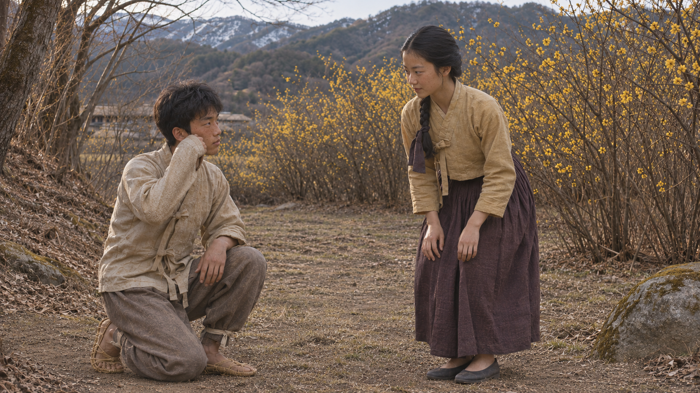

#### 영상 한글
```text
S09-02 | Flow AI | 생성 8초 / 편집 8초
1930년대 강원 농촌, 이른 봄. 16:9 시네마틱 실사, 자연광, 흙빛 색감.
시작 상태: 소매로 눈을 닦기 직전 — 첨부 키 이미지와 동일한 상태.
행동: 나가 소매로 눈을 문지른다. 점순이가 다가와 몸을 낮춘다.
카메라: 미디엄 클로즈업·50mm·고정. 시작 이미지와 같은 앵글, 한 번의 연속 숏, 임의 컷 전환 없음.
한국어 육성 대사: 점순이: 다시는 안 그럴 거지?
환경음·효과음: 소매 스침 / 옷자락, 낮은 바람.
첫 프레임은 첨부한 S09-02.png 그대로 시작한다. 최초 선택 인물의 얼굴·머리·의상·고름·체형과 소품·광선을 유지한다. 화면에 어머니나 제3인물, 추가 손을 만들지 않는다. 어머니는 S03과 S10에서만 화면 밖 음성이다. 배경음악·설명 내레이션·화면 글자·자막·캡션·워터마크 없음. 동물 타격 접촉·상처·피 없음.
생성 길이 8초. 편집본에는 앞 8초를 사용한다. 핵심 동작과 대사는 8초 안에 끝내고 남은 시간은 종료 자세를 자연스럽게 유지한다.
```

#### Video English
```text
S09-02 | Flow AI | Generate 8s / Edit 8s
Early spring, 1930s rural Gangwon Korea. 16:9 cinematic live action, natural light, earthy palette.
START STATE: Boy kneels frame left with tears on cheek, ivory sleeve still lowered BEFORE wiping eyes. Jeomsun upright frame right a short step away BEFORE lowering herself to eye level. Medium two-shot, yellow shrubs. No other people. Late afternoon.
ACTION: The boy wipes his eyes with his ivory sleeve. Jeomsun steps closer and lowers herself to his eye level.
CAMERA: Medium close-up, 50mm, locked off; maintain start-frame angle, one continuous shot, no spontaneous cuts.
Spoken ORIGINAL KOREAN, never translated: 점순이: 다시는 안 그럴 거지?
Diegetic sounds: Sleeve brushing skin / Cloth, soft breeze.
Start exactly from the attached S09-02.png. Preserve original approved identities, hair, clothing, goreum, body builds, props and light. NO mother or third human or extra hands appears. Mothers are offscreen voices only in S03 and S10. No music, narration, on-screen text, subtitles, captions or watermark; no animal impact, wounds or blood.
Generate 8 seconds. Use the FIRST 8 seconds in the edit. Finish the essential action and dialogue within 8 seconds, then hold the final posture naturally.
```

#### 시작 이미지 프롬프트
```text
ONE single WIDE 16:9 live-action photorealistic START FRAME of an 8-second film clip. Early spring, 1930s rural Gangwon Korea, muted earth colors, unretouched skin, natural soft light, subtle film grain. Identity reference contains ONLY boy on left and girl on right: faithfully preserve their faces, bodies, original hair, original clothing and original goreum knots. Boy: short untidy black hair, faded ivory jeogori, grey-brown baji, straw sandals. Girl: round face, one black braid with dark ribbon, muted ochre jeogori, dark plum chima, black rubber shoes. Use location and prop boards only for environment/object appearance, never their layout. CRITICAL: NO MOTHER, NO ADULT WOMAN, NO THIRD HUMAN, NO bystander, NO extra hands, NO silhouette. Include only explicitly requested characters; if an isolated closeup, no other face. Image is the instant BEFORE the named action, not mid-action or its ending. No collage, no panels, no text, no captions, no logo, no modern objects, no costume redesign, no animal impact/blood/wounds. Spicebush flowers yellow, not red camellia. Hodeugi is a short straight bark tube, not a smoking pipe. START COMPOSITION: Boy kneels frame left with tears on cheek, ivory sleeve still lowered BEFORE wiping eyes. Jeomsun upright frame right a short step away BEFORE lowering herself to eye level. Medium two-shot, yellow shrubs. No other people. Late afternoon.
```


### S09-03 · 196–204초 · 생성8초/편집8초

시작: 고개를 끄덕이기 직전

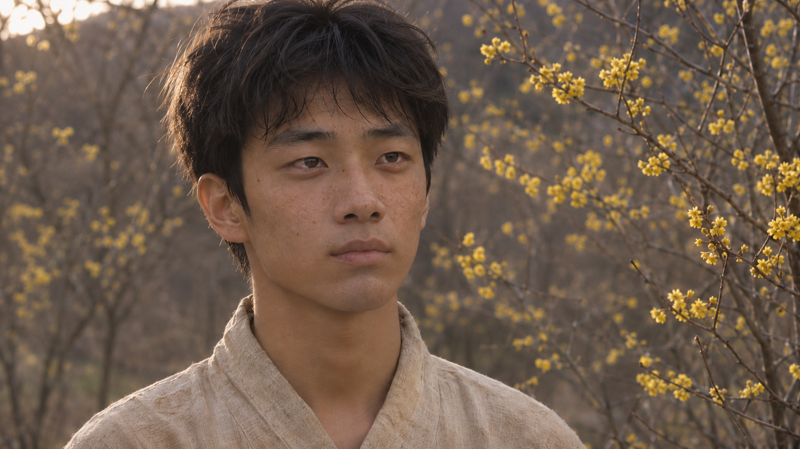

#### 영상 한글
```text
S09-03 | Flow AI | 생성 8초 / 편집 8초
1930년대 강원 농촌, 이른 봄. 16:9 시네마틱 실사, 자연광, 흙빛 색감.
시작 상태: 고개를 끄덕이기 직전 — 첨부 키 이미지와 동일한 상태.
행동: 나가 고개를 끄덕인다.
카메라: 나의 클로즈업·65mm·고정. 시작 이미지와 같은 앵글, 한 번의 연속 숏, 임의 컷 전환 없음.
한국어 육성 대사: 나: 응.
환경음·효과음: 짧은 숨.
첫 프레임은 첨부한 S09-03.png 그대로 시작한다. 최초 선택 인물의 얼굴·머리·의상·고름·체형과 소품·광선을 유지한다. 화면에 어머니나 제3인물, 추가 손을 만들지 않는다. 어머니는 S03과 S10에서만 화면 밖 음성이다. 배경음악·설명 내레이션·화면 글자·자막·캡션·워터마크 없음. 동물 타격 접촉·상처·피 없음.
생성 길이 8초. 편집본에는 앞 8초를 사용한다. 핵심 동작과 대사는 8초 안에 끝내고 남은 시간은 종료 자세를 자연스럽게 유지한다.
```

#### Video English
```text
S09-03 | Flow AI | Generate 8s / Edit 8s
Early spring, 1930s rural Gangwon Korea. 16:9 cinematic live action, natural light, earthy palette.
START STATE: ONLY boy closeup, tear marks and slightly wet ivory sleeve, head still neutral BEFORE nodding once, looking to Jeomsun offscreen right. Yellow grove, late afternoon.
ACTION: The boy nods.
CAMERA: Boy’s close-up, 65mm, locked off; maintain start-frame angle, one continuous shot, no spontaneous cuts.
Spoken ORIGINAL KOREAN, never translated: 나: 응.
Diegetic sounds: Short breath.
Start exactly from the attached S09-03.png. Preserve original approved identities, hair, clothing, goreum, body builds, props and light. NO mother or third human or extra hands appears. Mothers are offscreen voices only in S03 and S10. No music, narration, on-screen text, subtitles, captions or watermark; no animal impact, wounds or blood.
Generate 8 seconds. Use the FIRST 8 seconds in the edit. Finish the essential action and dialogue within 8 seconds, then hold the final posture naturally.
```

#### 시작 이미지 프롬프트
```text
ONE single WIDE 16:9 live-action photorealistic START FRAME of an 8-second film clip. Early spring, 1930s rural Gangwon Korea, muted earth colors, unretouched skin, natural soft light, subtle film grain. Identity reference contains ONLY boy on left and girl on right: faithfully preserve their faces, bodies, original hair, original clothing and original goreum knots. Boy: short untidy black hair, faded ivory jeogori, grey-brown baji, straw sandals. Girl: round face, one black braid with dark ribbon, muted ochre jeogori, dark plum chima, black rubber shoes. Use location and prop boards only for environment/object appearance, never their layout. CRITICAL: NO MOTHER, NO ADULT WOMAN, NO THIRD HUMAN, NO bystander, NO extra hands, NO silhouette. Include only explicitly requested characters; if an isolated closeup, no other face. Image is the instant BEFORE the named action, not mid-action or its ending. No collage, no panels, no text, no captions, no logo, no modern objects, no costume redesign, no animal impact/blood/wounds. Spicebush flowers yellow, not red camellia. Hodeugi is a short straight bark tube, not a smoking pipe. START COMPOSITION: ONLY boy closeup, tear marks and slightly wet ivory sleeve, head still neutral BEFORE nodding once, looking to Jeomsun offscreen right. Yellow grove, late afternoon.
```


### S09-04 · 204–210초 · 생성8초/편집6초

시작: 약속하기 직전

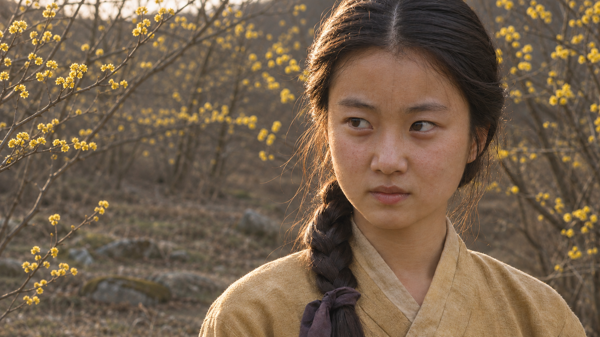

#### 영상 한글
```text
S09-04 | Flow AI | 생성 8초 / 편집 6초
1930년대 강원 농촌, 이른 봄. 16:9 시네마틱 실사, 자연광, 흙빛 색감.
시작 상태: 약속하기 직전 — 첨부 키 이미지와 동일한 상태.
행동: 점순이가 나의 눈을 바라본다.
카메라: 점순이 클로즈업·65mm·느린 전진. 시작 이미지와 같은 앵글, 한 번의 연속 숏, 임의 컷 전환 없음.
한국어 육성 대사: 점순이: 그럼 나도 말 안 해.
환경음·효과음: 바람.
첫 프레임은 첨부한 S09-04.png 그대로 시작한다. 최초 선택 인물의 얼굴·머리·의상·고름·체형과 소품·광선을 유지한다. 화면에 어머니나 제3인물, 추가 손을 만들지 않는다. 어머니는 S03과 S10에서만 화면 밖 음성이다. 배경음악·설명 내레이션·화면 글자·자막·캡션·워터마크 없음. 동물 타격 접촉·상처·피 없음.
생성 길이 8초. 편집본에는 앞 6초를 사용한다. 핵심 동작과 대사는 6초 안에 끝내고 남은 시간은 종료 자세를 자연스럽게 유지한다.
```

#### Video English
```text
S09-04 | Flow AI | Generate 8s / Edit 6s
Early spring, 1930s rural Gangwon Korea. 16:9 cinematic live action, natural light, earthy palette.
START STATE: ONLY Jeomsun face closeup at boy’s eye level, restrained soft gaze offscreen left, mouth closed BEFORE saying she will keep it secret. Braid and original ochre jacket, yellow grove. Late afternoon.
ACTION: Jeomsun holds the boy’s gaze.
CAMERA: Jeomsun close-up, 65mm, slow push in; maintain start-frame angle, one continuous shot, no spontaneous cuts.
Spoken ORIGINAL KOREAN, never translated: 점순이: 그럼 나도 말 안 해.
Diegetic sounds: Breeze.
Start exactly from the attached S09-04.png. Preserve original approved identities, hair, clothing, goreum, body builds, props and light. NO mother or third human or extra hands appears. Mothers are offscreen voices only in S03 and S10. No music, narration, on-screen text, subtitles, captions or watermark; no animal impact, wounds or blood.
Generate 8 seconds. Use the FIRST 6 seconds in the edit. Finish the essential action and dialogue within 6 seconds, then hold the final posture naturally.
```

#### 시작 이미지 프롬프트
```text
ONE single WIDE 16:9 live-action photorealistic START FRAME of an 8-second film clip. Early spring, 1930s rural Gangwon Korea, muted earth colors, unretouched skin, natural soft light, subtle film grain. Identity reference contains ONLY boy on left and girl on right: faithfully preserve their faces, bodies, original hair, original clothing and original goreum knots. Boy: short untidy black hair, faded ivory jeogori, grey-brown baji, straw sandals. Girl: round face, one black braid with dark ribbon, muted ochre jeogori, dark plum chima, black rubber shoes. Use location and prop boards only for environment/object appearance, never their layout. CRITICAL: NO MOTHER, NO ADULT WOMAN, NO THIRD HUMAN, NO bystander, NO extra hands, NO silhouette. Include only explicitly requested characters; if an isolated closeup, no other face. Image is the instant BEFORE the named action, not mid-action or its ending. No collage, no panels, no text, no captions, no logo, no modern objects, no costume redesign, no animal impact/blood/wounds. Spicebush flowers yellow, not red camellia. Hodeugi is a short straight bark tube, not a smoking pipe. START COMPOSITION: ONLY Jeomsun face closeup at boy’s eye level, restrained soft gaze offscreen left, mouth closed BEFORE saying she will keep it secret. Braid and original ochre jacket, yellow grove. Late afternoon.
```


## S10 꽃 속으로 — 30초

등장: 나 C01 / 점순이 C02 / 점순이 어머니 C04(목소리)


### S10-01 · 210–218초 · 생성8초/편집8초

시작: 어깨를 밀기 직전

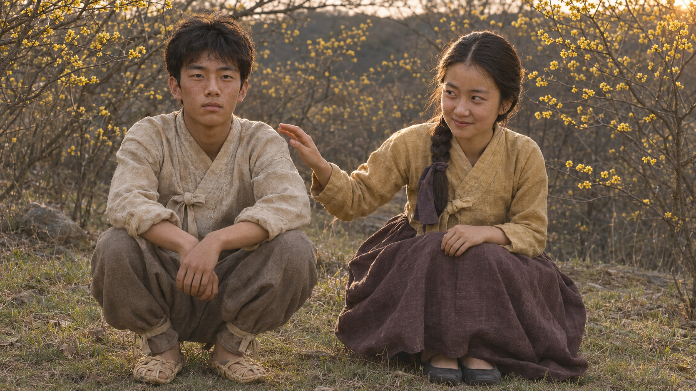

#### 영상 한글
```text
S10-01 | Flow AI | 생성 8초 / 편집 8초
1930년대 강원 농촌, 이른 봄. 16:9 시네마틱 실사, 자연광, 흙빛 색감.
시작 상태: 어깨를 밀기 직전 — 첨부 키 이미지와 동일한 상태.
행동: 점순이가 나의 어깨를 가볍게 민다. 점순이가 균형을 잃는 나의 소매를 잡는다.
카메라: 미디엄 투숏·35mm·고정. 시작 이미지와 같은 앵글, 한 번의 연속 숏, 임의 컷 전환 없음.
대사 없음.
환경음·효과음: 옷자락 / 옷자락 스침.
첫 프레임은 첨부한 S10-01.png 그대로 시작한다. 최초 선택 인물의 얼굴·머리·의상·고름·체형과 소품·광선을 유지한다. 화면에 어머니나 제3인물, 추가 손을 만들지 않는다. 어머니는 S03과 S10에서만 화면 밖 음성이다. 배경음악·설명 내레이션·화면 글자·자막·캡션·워터마크 없음. 동물 타격 접촉·상처·피 없음.
생성 길이 8초. 편집본에는 앞 8초를 사용한다. 핵심 동작과 대사는 8초 안에 끝내고 남은 시간은 종료 자세를 자연스럽게 유지한다.
```

#### Video English
```text
S10-01 | Flow AI | Generate 8s / Edit 8s
Early spring, 1930s rural Gangwon Korea. 16:9 cinematic live action, natural light, earthy palette.
START STATE: Boy frame left and Jeomsun frame right stand or low crouch beside soft grass under yellow spicebush. Girl’s hand just short of boy’s shoulder BEFORE a light nudge, boy balanced, no one falling yet. Medium two-shot, gradually warm sunset light.
ACTION: Jeomsun lightly nudges the boy’s shoulder. Jeomsun catches the boy’s sleeve as he loses balance.
CAMERA: Medium two-shot, 35mm, locked off; maintain start-frame angle, one continuous shot, no spontaneous cuts.
No dialogue.
Diegetic sounds: Cloth rustle / Fabric movement.
Start exactly from the attached S10-01.png. Preserve original approved identities, hair, clothing, goreum, body builds, props and light. NO mother or third human or extra hands appears. Mothers are offscreen voices only in S03 and S10. No music, narration, on-screen text, subtitles, captions or watermark; no animal impact, wounds or blood.
Generate 8 seconds. Use the FIRST 8 seconds in the edit. Finish the essential action and dialogue within 8 seconds, then hold the final posture naturally.
```

#### 시작 이미지 프롬프트
```text
ONE single WIDE 16:9 live-action photorealistic START FRAME of an 8-second film clip. Early spring, 1930s rural Gangwon Korea, muted earth colors, unretouched skin, natural soft light, subtle film grain. Identity reference contains ONLY boy on left and girl on right: faithfully preserve their faces, bodies, original hair, original clothing and original goreum knots. Boy: short untidy black hair, faded ivory jeogori, grey-brown baji, straw sandals. Girl: round face, one black braid with dark ribbon, muted ochre jeogori, dark plum chima, black rubber shoes. Use location and prop boards only for environment/object appearance, never their layout. CRITICAL: NO MOTHER, NO ADULT WOMAN, NO THIRD HUMAN, NO bystander, NO extra hands, NO silhouette. Include only explicitly requested characters; if an isolated closeup, no other face. Image is the instant BEFORE the named action, not mid-action or its ending. No collage, no panels, no text, no captions, no logo, no modern objects, no costume redesign, no animal impact/blood/wounds. Spicebush flowers yellow, not red camellia. Hodeugi is a short straight bark tube, not a smoking pipe. START COMPOSITION: Boy frame left and Jeomsun frame right stand or low crouch beside soft grass under yellow spicebush. Girl’s hand just short of boy’s shoulder BEFORE a light nudge, boy balanced, no one falling yet. Medium two-shot, gradually warm sunset light.
```


### S10-02 · 218–226초 · 생성8초/편집8초

시작: 꽃밭에 넘어지기 직전

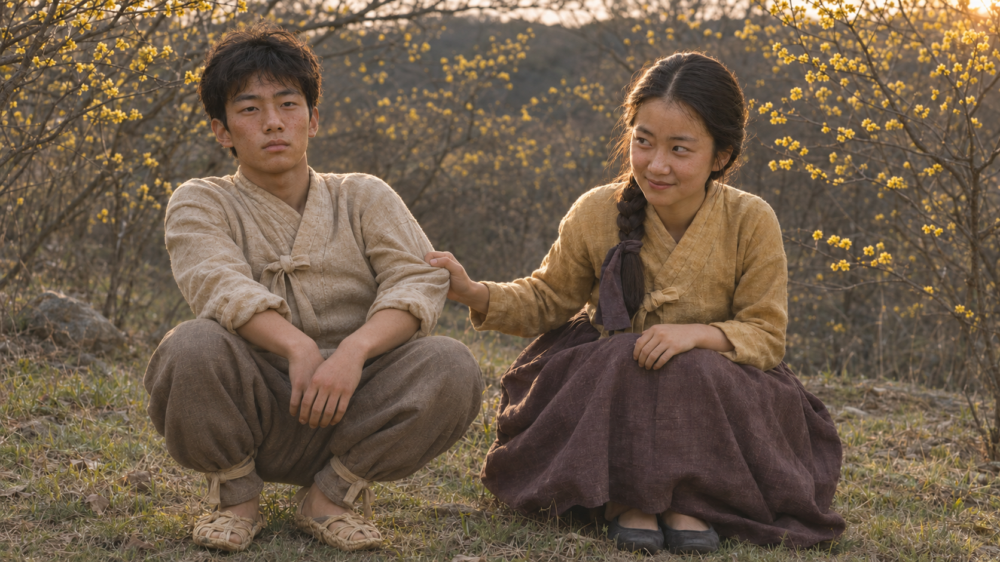

#### 영상 한글
```text
S10-02 | Flow AI | 생성 8초 / 편집 8초
1930년대 강원 농촌, 이른 봄. 16:9 시네마틱 실사, 자연광, 흙빛 색감.
시작 상태: 꽃밭에 넘어지기 직전 — 첨부 키 이미지와 동일한 상태.
행동: 두 사람이 풀밭에 나란히 내려앉는다. 꽃가지 아래에서 두 사람이 서로를 바라본다.
카메라: 낮게 웅크린 두 사람의 눈높이 미디엄 투숏·35mm·고정. 시작 이미지와 같은 앵글, 한 번의 연속 숏, 임의 컷 전환 없음.
대사 없음.
환경음·효과음: 풀밭에 닿는 몸 / 두 사람의 숨, 꽃가지 바람.
첫 프레임은 첨부한 S10-02.png 그대로 시작한다. 최초 선택 인물의 얼굴·머리·의상·고름·체형과 소품·광선을 유지한다. 화면에 어머니나 제3인물, 추가 손을 만들지 않는다. 어머니는 S03과 S10에서만 화면 밖 음성이다. 배경음악·설명 내레이션·화면 글자·자막·캡션·워터마크 없음. 동물 타격 접촉·상처·피 없음.
생성 길이 8초. 편집본에는 앞 8초를 사용한다. 핵심 동작과 대사는 8초 안에 끝내고 남은 시간은 종료 자세를 자연스럽게 유지한다.
```

#### Video English
```text
S10-02 | Flow AI | Generate 8s / Edit 8s
Early spring, 1930s rural Gangwon Korea. 16:9 cinematic live action, natural light, earthy palette.
START STATE: Boy frame left and girl frame right REMAIN LOW CROUCHING above grass, not standing. Boy begins to lean back slightly while Jeomsun catches his ivory sleeve, BEFORE both settle side by side. Modest fully clothed innocent interaction. Eye-level medium two-shot, yellow flower twigs overhead, warm natural sunset.
ACTION: Both settle gently side by side into the soft grass. Under swaying yellow flowering twigs, they look at each other with a restrained innocent smile.
CAMERA: Eye-level medium two-shot of both low-crouching characters, 35mm, locked off; maintain start-frame angle, one continuous shot, no spontaneous cuts.
No dialogue.
Diegetic sounds: Soft bodies on grass / Breathing, breeze in twigs.
Start exactly from the attached S10-02.png. Preserve original approved identities, hair, clothing, goreum, body builds, props and light. NO mother or third human or extra hands appears. Mothers are offscreen voices only in S03 and S10. No music, narration, on-screen text, subtitles, captions or watermark; no animal impact, wounds or blood.
Generate 8 seconds. Use the FIRST 8 seconds in the edit. Finish the essential action and dialogue within 8 seconds, then hold the final posture naturally.
```

#### 시작 이미지 프롬프트
```text
ONE single WIDE 16:9 live-action photorealistic START FRAME of an 8-second film clip. Early spring, 1930s rural Gangwon Korea, muted earth colors, unretouched skin, natural soft light, subtle film grain. Identity reference contains ONLY boy on left and girl on right: faithfully preserve their faces, bodies, original hair, original clothing and original goreum knots. Boy: short untidy black hair, faded ivory jeogori, grey-brown baji, straw sandals. Girl: round face, one black braid with dark ribbon, muted ochre jeogori, dark plum chima, black rubber shoes. Use location and prop boards only for environment/object appearance, never their layout. CRITICAL: NO MOTHER, NO ADULT WOMAN, NO THIRD HUMAN, NO bystander, NO extra hands, NO silhouette. Include only explicitly requested characters; if an isolated closeup, no other face. Image is the instant BEFORE the named action, not mid-action or its ending. No collage, no panels, no text, no captions, no logo, no modern objects, no costume redesign, no animal impact/blood/wounds. Spicebush flowers yellow, not red camellia. Hodeugi is a short straight bark tube, not a smoking pipe. START COMPOSITION: Boy frame left and girl frame right REMAIN LOW CROUCHING above grass, not standing. Boy begins to lean back slightly while Jeomsun catches his ivory sleeve, BEFORE both settle side by side. Modest fully clothed innocent interaction. Eye-level medium two-shot, yellow flower twigs overhead, warm natural sunset.
```


### S10-03 · 226–234초 · 생성8초/편집8초

시작: 엄마의 부름을 듣기 직전

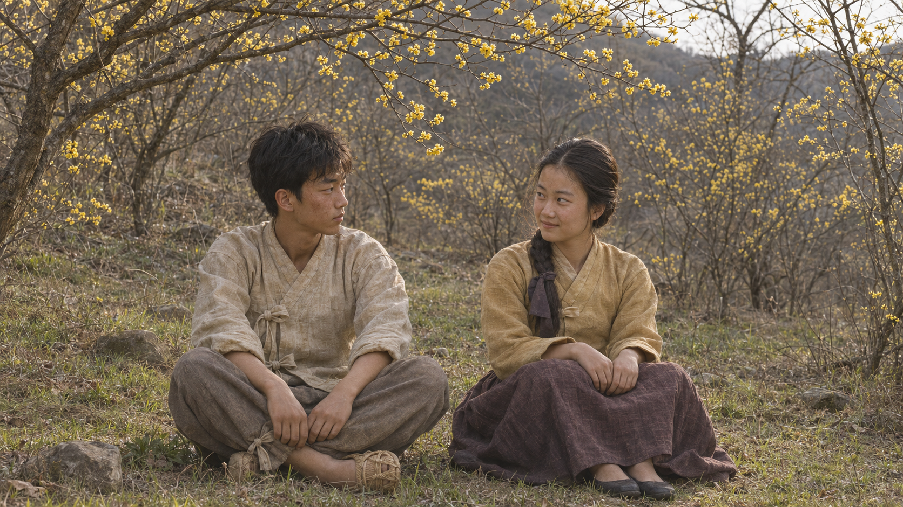

#### 영상 한글
```text
S10-03 | Flow AI | 생성 8초 / 편집 8초
1930년대 강원 농촌, 이른 봄. 16:9 시네마틱 실사, 자연광, 흙빛 색감.
시작 상태: 엄마의 부름을 듣기 직전 — 첨부 키 이미지와 동일한 상태.
행동: 멀리서 부르는 소리에 점순이가 일어나 달려간다.
카메라: 와이드·35mm·짧은 팬. 시작 이미지와 같은 앵글, 한 번의 연속 숏, 임의 컷 전환 없음.
한국어 육성 대사: 점순이 어머니(화면 밖 멀리서): 점순아! / 점순이(작게): 먼저 가.
환경음·효과음: 멀어지는 발소리.
첫 프레임은 첨부한 S10-03.png 그대로 시작한다. 최초 선택 인물의 얼굴·머리·의상·고름·체형과 소품·광선을 유지한다. 화면에 어머니나 제3인물, 추가 손을 만들지 않는다. 어머니는 S03과 S10에서만 화면 밖 음성이다. 배경음악·설명 내레이션·화면 글자·자막·캡션·워터마크 없음. 동물 타격 접촉·상처·피 없음.
생성 길이 8초. 편집본에는 앞 8초를 사용한다. 핵심 동작과 대사는 8초 안에 끝내고 남은 시간은 종료 자세를 자연스럽게 유지한다.
```

#### Video English
```text
S10-03 | Flow AI | Generate 8s / Edit 8s
Early spring, 1930s rural Gangwon Korea. 16:9 cinematic live action, natural light, earthy palette.
START STATE: Boy and Jeomsun seated side by side in low grass after gentle fall, both fully clothed, looking at each other. Jeomsun not yet standing, BEFORE unseen mother calls and she leaves. Yellow flowering twigs overhead. Wide shot. No mother or other person visible.
ACTION: At a distant call, Jeomsun gets up and runs between the shrubs.
CAMERA: Wide, 35mm, short pan; maintain start-frame angle, one continuous shot, no spontaneous cuts.
Spoken ORIGINAL KOREAN, never translated: 점순이 어머니(화면 밖 멀리서): 점순아! / 점순이(작게): 먼저 가.
Diegetic sounds: Receding footsteps.
Start exactly from the attached S10-03.png. Preserve original approved identities, hair, clothing, goreum, body builds, props and light. NO mother or third human or extra hands appears. Mothers are offscreen voices only in S03 and S10. No music, narration, on-screen text, subtitles, captions or watermark; no animal impact, wounds or blood.
Generate 8 seconds. Use the FIRST 8 seconds in the edit. Finish the essential action and dialogue within 8 seconds, then hold the final posture naturally.
```

#### 시작 이미지 프롬프트
```text
ONE single WIDE 16:9 live-action photorealistic START FRAME of an 8-second film clip. Early spring, 1930s rural Gangwon Korea, muted earth colors, unretouched skin, natural soft light, subtle film grain. Identity reference contains ONLY boy on left and girl on right: faithfully preserve their faces, bodies, original hair, original clothing and original goreum knots. Boy: short untidy black hair, faded ivory jeogori, grey-brown baji, straw sandals. Girl: round face, one black braid with dark ribbon, muted ochre jeogori, dark plum chima, black rubber shoes. Use location and prop boards only for environment/object appearance, never their layout. CRITICAL: NO MOTHER, NO ADULT WOMAN, NO THIRD HUMAN, NO bystander, NO extra hands, NO silhouette. Include only explicitly requested characters; if an isolated closeup, no other face. Image is the instant BEFORE the named action, not mid-action or its ending. No collage, no panels, no text, no captions, no logo, no modern objects, no costume redesign, no animal impact/blood/wounds. Spicebush flowers yellow, not red camellia. Hodeugi is a short straight bark tube, not a smoking pipe. START COMPOSITION: Boy and Jeomsun seated side by side in low grass after gentle fall, both fully clothed, looking at each other. Jeomsun not yet standing, BEFORE unseen mother calls and she leaves. Yellow flowering twigs overhead. Wide shot. No mother or other person visible.
```


### S10-04 · 234–240초 · 생성8초/편집6초

시작: 소매의 꽃을 집기 직전


#### 영상 한글
```text
S10-04 | Flow AI | 생성 8초 / 편집 6초
1930년대 강원 농촌, 이른 봄. 16:9 시네마틱 실사, 자연광, 흙빛 색감.
시작 상태: 소매의 꽃을 집기 직전 — 첨부 키 이미지와 동일한 상태.
행동: 처음에는 양손이 프레임 밖에 있다. 나의 오른손 하나가 프레임 오른쪽에서 들어와 왼쪽 소매 위 노란 꽃 한 송이를 집는다.
카메라: 소매와 꽃 인서트·약간 내려다보는 앵글·65mm·고정. 시작 이미지와 같은 앵글, 한 번의 연속 숏, 임의 컷 전환 없음.
대사 없음.
환경음·효과음: 낮은 바람.
첫 프레임은 첨부한 S10-04.png 그대로 시작한다. 최초 선택 인물의 얼굴·머리·의상·고름·체형과 소품·광선을 유지한다. 화면에 어머니나 제3인물, 추가 손을 만들지 않는다. 어머니는 S03과 S10에서만 화면 밖 음성이다. 배경음악·설명 내레이션·화면 글자·자막·캡션·워터마크 없음. 동물 타격 접촉·상처·피 없음.
생성 길이 8초. 편집본에는 앞 6초를 사용한다. 핵심 동작과 대사는 6초 안에 끝내고 남은 시간은 종료 자세를 자연스럽게 유지한다.
```

#### Video English
```text
S10-04 | Flow AI | Generate 8s / Edit 6s
Early spring, 1930s rural Gangwon Korea. 16:9 cinematic live action, natural light, earthy palette.
START STATE: Slightly top-down close insert of ONLY the boy’s relaxed LEFT forearm in ivory sleeve resting across one grey-brown thigh. Exactly ONE tiny yellow spicebush blossom on the sleeve. Both hands are completely OUTSIDE the crop. His RIGHT hand will enter from frame right later in the video to pick the blossom. Girl has already left. Soft grass, yellow grove, sunset. No face.
ACTION: Both hands begin outside the crop. The boy’s single right hand enters from frame right and picks the one tiny yellow blossom from his left sleeve.
CAMERA: Sleeve and blossom insert, slightly top-down, 65mm, locked off; maintain start-frame angle, one continuous shot, no spontaneous cuts.
No dialogue.
Diegetic sounds: Soft breeze.
Start exactly from the attached S10-04.png. Preserve original approved identities, hair, clothing, goreum, body builds, props and light. NO mother or third human or extra hands appears. Mothers are offscreen voices only in S03 and S10. No music, narration, on-screen text, subtitles, captions or watermark; no animal impact, wounds or blood.
Generate 8 seconds. Use the FIRST 6 seconds in the edit. Finish the essential action and dialogue within 6 seconds, then hold the final posture naturally.
```

#### 시작 이미지 프롬프트
```text
ONE single WIDE 16:9 live-action photorealistic START FRAME of an 8-second film clip. Early spring, 1930s rural Gangwon Korea, muted earth colors, unretouched skin, natural soft light, subtle film grain. Identity reference contains ONLY boy on left and girl on right: faithfully preserve their faces, bodies, original hair, original clothing and original goreum knots. Boy: short untidy black hair, faded ivory jeogori, grey-brown baji, straw sandals. Girl: round face, one black braid with dark ribbon, muted ochre jeogori, dark plum chima, black rubber shoes. Use location and prop boards only for environment/object appearance, never their layout. CRITICAL: NO MOTHER, NO ADULT WOMAN, NO THIRD HUMAN, NO bystander, NO extra hands, NO silhouette. Include only explicitly requested characters; if an isolated closeup, no other face. Image is the instant BEFORE the named action, not mid-action or its ending. No collage, no panels, no text, no captions, no logo, no modern objects, no costume redesign, no animal impact/blood/wounds. Spicebush flowers yellow, not red camellia. Hodeugi is a short straight bark tube, not a smoking pipe. START COMPOSITION: Slightly top-down close insert of ONLY the boy’s relaxed LEFT forearm in ivory sleeve resting across one grey-brown thigh. Exactly ONE tiny yellow spicebush blossom on the sleeve. Both hands are completely OUTSIDE the crop. His RIGHT hand will enter from frame right later in the video to pick the blossom. Girl has already left. Soft grass, yellow grove, sunset. No face.
```
